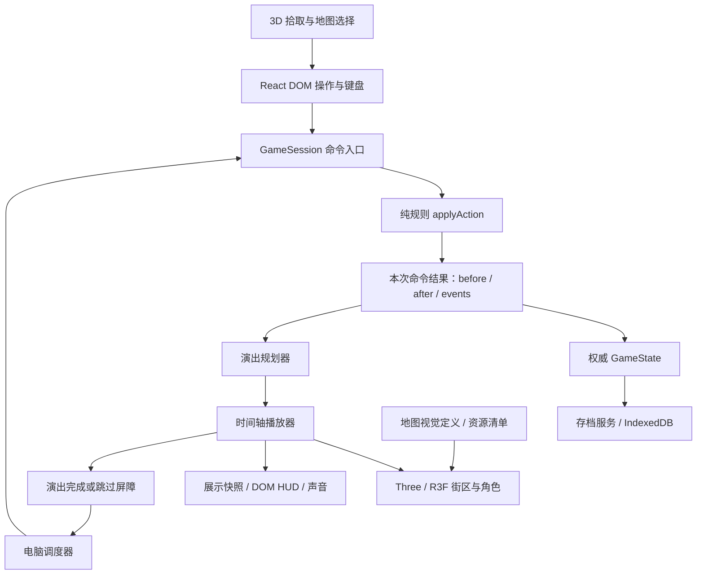

# 03 · 前端架构

本文件定义目标接口和目录，**不是已经存在的实现**。技术取舍服务于一张完整可玩的地图，不先建设通用游戏引擎、ECS、编辑器平台或联网框架。

## 技术组合

| 职责 | 首选 | 取舍 |
| --- | --- | --- |
| 应用与中文 UI | React + TypeScript，目标 React 19 | DOM 保留表单、可访问性与复杂交易；先单独验证现有 React 18/UMD 向 ESM 的迁移 |
| 世界渲染 | Three.js + React Three Fiber 9 | 与 React 19 配对；R3F 管场景生命周期与交互，Three.js 管空间与动画；只装必要的辅助库 |
| 渲染后端 | WebGL2 | 首版不依赖 WebGPU，不进入 Fiber 10 alpha；WebGL2 不可用时提供简化棋盘与存档导出 |
| 构建 | Vite 的静态多入口构建 + tsc 类型/核心输出 | GitHub Pages `/ReactMono/` base；哈希资源、分块、同源离线 |
| 状态 | 小型外部 SessionStore + React `useSyncExternalStore` | 一个规则状态权威；不先叠加 Redux、Zustand 和另一套场景业务 store |
| 资源 | Blender 源文件 → glTF 2.0 / GLB | 可重导出，可做模块和动画复用；源文件不进入发行目录 |
| 动画 | 确定性演出时间轴 + Three AnimationMixer | 无物理引擎决定骰子；首轮无需 Rapier、GSAP 或多套互相竞争的时钟 |
| 保存与音频 | 现有 IndexedDB/存档校验；Web Audio 接入服务 | 保持离线、手势解锁、静音与资源生命周期 |

官方要求 Fiber 与 React 主版本配对：Fiber 8 对 React 18，Fiber 9 对 React 19。具体 React/Three/Fiber/Vite/类型包版本在首个技术切片中检查 peer dependencies、锁定 lockfile 并通过 CI；本文不是“安装 latest”的指令。[R3F 官方版本说明](https://r3f.docs.pmnd.rs/getting-started/introduction)

若 React 19 迁移暴露实质不兼容，允许把 **React 18 ESM + Fiber 8** 作为有记录的短期退路；不能混用 React 18/Fiber 9，也不能在同一页面加载 UMD React 和另一份 ESM React。

## 数据流与依赖方向



规则核心不 import React、Three、DOM、IndexedDB 或真实时钟。应用层调用核心；表现层只消费只读投影与演出计划，输入经应用层转换为命令；保存服务只写权威状态。不要让 `Character.onAnimationEnd` 调用 `buy_property` 或结算租金。

## 目标目录与职责

```text
src/
  core/                         # 原规则、地图拓扑、随机数、保存协议、AI
  application/
    game-session.ts             # 唯一命令入口、session epoch、版本校验
    session-store.ts            # 权威快照、订阅；不含 Three 对象
    command-result.ts           # 成功/拒绝、命令前后快照与事件
    computer-controller.ts     # 策略调用、暂停、防循环、演出屏障
    save-coordinator.ts        # 最新快照队列、读档/更新屏障
  presentation/
    event-normalizer.ts        # 现有松散事件 → 类型化表现事实
    plan.ts                    # 事件 → 有依赖的演出片段
    player.ts                  # 单时钟、skip、cancel、watchdog
    projection.ts              # 状态 → 角色/产权/金额的只读展示值
    view-store.ts              # 低频展示快照、selectedTile、面板状态
  world/
    WorldCanvas.tsx            # WebGL 边界、相机、帧循环
    map/                       # 道路、建筑、地块与拾取代理
    actors/                    # CharacterView、骨架与动画
    effects/                   # 骰子、金币、建造、路障
    camera/                    # 安全区域跟随、缩放与遮挡处理
    assets/                    # 缓存、实例化、加载失败与释放
  ui/
    shell/                     # 开局、对局、暂停、设置、结算
    hud/                       # 玩家条、手牌、当前行动
    panels/                    # 地产、银行、股票、存档
    accessibility/             # 地块语义列表、键盘与播报
    fallback/                  # WebGL 故障时的薄 DOM 棋盘
  content/scenes/               # classic-24@1、harbor-20@1 的视觉布局
  storage/                     # 保留 IndexedDB 数据访问
assets-source/                  # .blend、源音频、导出配置、创作记录
public/assets/                  # 导出的 GLB、图标、音频；实际组织按构建配置
tests/                         # 核心回归、表现计划、浏览器与资源验收
```

每个目录只在相应切片需要时创建，不先生成空壳文件。玩家能力、位置、现金均不复制到 `world/` 作为可独立修改的业务状态。

## 规则状态与展示状态

三个层次不可混淆：

1. **GameState**：唯一真实局面，命令成功时立即提交；存档、AI 和规则检查读取它。
2. **ViewSnapshot**：角色、产权、当前行动者、HUD 数字等展示投影。演出中可暂时停留在命令前版本，状态标签写“行动演出中”；不会用于合法性判断。
3. **帧内姿态**：位置插值、朝向、骨骼和粒子。保存在 Three 对象/ref，由播放器更新；不进入 React state、存档或随机数流。

低频快照通知 DOM；每帧姿态不得调用整页 `setState`。R3F 建议把高频更新留在帧循环中，使用时间差和对象复用。[性能陷阱](https://r3f.docs.pmnd.rs/advanced/pitfalls)

### 命令提交契约（拟议）

```ts
type CommandEnvelope = {
  sessionEpoch: number;
  expectedRevision: number;
  commandId: string;
  action: GameAction;
};
type AcceptedCommand = {
  sessionEpoch: number;
  commandId: string;
  before: GameState;
  after: GameState;
  events: readonly GameEvent[]; // 只取本次 ActionResult.events
};
```

`GameSession.dispatch` 同步检查 epoch、revision、当前操作者及输入门，再调用一次 `applyAction`；成功则保存新状态并发出结果，拒绝则维持状态且只显示错误。commandId 做会话内去重；不把同一次成功命令因双击或 React 重挂载再执行一遍。命令在 await 之前取得处理锁，拒绝旧版本点击。

`before/after` 是不可变引用，只在正在播放的结果内保留；播完即释放。完整历史不再复制进另一条无限队列。`GameState.revision` 在新局可能重复，因此 **epoch + revision** 才能判定回调属于哪一局。epoch 是会话生命周期标识，不写入旧存档。

### 一次投骰的展示事务

- 规则先返回最终位置、资产、状态和事件，自动存档立即排队；演出不延迟合法结算。
- 演出展示掷骰和路径，普通 HUD 数字、产权、行动者继续显示命令前投影；新购买按钮尚不可用。
- 在明确的“结算揭示点”，世界产权/角色状态与 HUD **一同切到 after 投影**，展示本次资金流和结果；使用事件金额作解释，不再计算一遍经济账。
- 所有揭示结束后，解除输入门/安排下一个电脑动作。若该命令已导致破产和换人，也要在当前人的演出结束后再交接。
- 在演出期间，玩家可看说明、调整音量、选地块、暂停或跳过；不能提交下一个改变游戏的命令。地块详情跟随展示版本并说明正在结算，避免提前泄露一半结果。
- 手动保存保存 after 权威状态，提示“已保存当前行动结果”；读档取消演出并直接显示已提交终态，不补播旧骰子或重复收租。

## 地图：规则拓扑与视觉布局分开

`GameMap.id/version/route` 继续定义合法路径。新增 `SceneDefinition` 只定义世界坐标与造型：

```text
sceneId, sceneVersion, mapId, mapVersion
tileBindings[tileId]: roadAnchor, lotAnchor, facing, occupancyAnchors[4]
routeEdges[fromTileId,toTileId]: pathPoints[]
lots[tileId]: buildingFamily, footprint, roofPolicy
decorations[], cameraBounds, safeFrame, assetPackId
```

`roadAnchor` 是角色所走的道路节点，`lotAnchor` 是它对应地产的建筑位置；两者通过地界/标记清楚关联，点击路面或房屋返回同一 tileId。交互语义不得因美术移动建筑而变化。

加载时验证：每个规则 tile 正好有一个绑定；每条 route 邻接边有连续路径；地块不重叠；道路不穿房屋；起终点一致；四人站位可用。首图仍是环线，不能为好看伪造规则不支持的岔路。视觉路面可以绕弯，但必须按定义边走。

经典和海港视觉定义按规则地图 id/version 查找。合法旧档若没有专用场景，生成按 `route` 顺序摆放的简化环线并保留全部 tileId/标题/规则；不把未知地图悄悄换成经典经济配置。非法或未来版本档仍由原校验器拒绝。

## 渲染与输入

- 一个主 Canvas，场景、相机、光照共享；骰子可用同一 renderer 的独立演出层/视口，不为每个 HUD 图标创建 WebGL context。
- 静态街区复用 geometry/material；路面、树和道具按资源批次实例化。少量有独立骨架的角色单独更新。
- 默认按需渲染：操作、镜头和时间轴活跃时请求帧；停稳后停止。低频待机眨眼可按时唤醒，不维持无意义的 60 Hz。[R3F 按需渲染](https://r3f.docs.pmnd.rs/advanced/scaling-performance)
- 角色/建筑拥有便宜的拾取代理。装饰不抢点击；从 instanceId 映射 tileId。点击选择，拖动平移，双指缩放；拖动超过阈值不触发买地。UI 面板优先捕获事件。
- 键盘和读屏使用 DOM 地块列表，可定位到场景并触发相同的详情/命令入口。Canvas 不是唯一操作方式。
- Renderer 创建失败显示中文错误和简化棋盘。Context lost 时暂停调度、结束表现事务到终态、保留存档；恢复后重建资源，失败则维持简化模式并可导出存档。现代 Three WebGLRenderer 依赖 WebGL2。[官方渲染器说明](https://threejs.org/docs/pages/WebGLRenderer.html)

## 生命周期与错误处理

GameSession 活得比 Canvas 长。换画质、重建 GPU 或切换面板不创建新局；新局/读档才递增 epoch。统一 `dispose()` 取消时间轴、AI timer、监听器、音频源和未完成资源请求。

模型加载按 pack 缓存，共享材质/几何由资源管理器计数释放；角色骨架必须有独立实例，不能四个人共用同一骨骼姿态。换图时释放旧实例及无人使用的 GPU 资源，不把 `scene.remove` 当作已释放显存。[Three 资源释放](https://threejs.org/manual/pages/cleanup.html)

缺少非关键装饰允许降级并记录；角色/骰子/地块等关键资源失败要显示明确占位形体和中文提示，提供重试/简化模式。不得用无限 loading 阻断已保存的游戏。异常诊断默认留本机，用户可主动导出，不引入遥测后端。

## 存档、构建与离线

**存档格式首轮保持不变。** 相机、画质、静音、角色外观映射归独立版本化本机偏好；旧档按玩家 ID/座位稳定映射默认形象。外观选择目前不改变人物规则属性，不能以美术迁移名义发明角色能力。

构建按以下目标迁移：

1. 单独完成 ESM、真实 React 类型和 `createRoot` 改造，再接 R3F。UI 与核心分别进行浏览器打包和 Node 测试；保持现有 `dist/core/*.js` 测试入口，过渡期也保留浏览器验收使用的核心模块。
2. 干净输出目录先清理，再写核心与 Vite 产物，避免后一步清空前一步或残留旧资源。旧 UI 保留为同一 React 运行时的过渡入口，不混载两个 React。
3. base 固定 `/ReactMono/`，所有模型/声音/动态 chunk 使用构建解析 URL；不写根路径 `/assets/...`。静态多入口或 hash 状态即可，无服务器路由要求。[Vite Pages 部署](https://vite.dev/guide/static-deploy.html)
4. 生成式 manifest 收集完整发行图，包括动态 chunk、GLB、纹理、音频和若启用压缩后的解码器。用实际字节哈希生成 releaseId；禁止依赖运行时 CDN。
5. 第一张正式地图和默认角色进入必需离线包；只有文件缓存完整、校验成功才显示“可离线游玩”。未下载的后续地图不能在离线时伪装可用。
6. 先把新缓存全部装好，再标为 ready；网络/配额失败保留旧版本及旧地图。未来可选地图包按 releaseId 分组；不混用新 JSON 绑定与旧 GLB。
7. 更新需用户选择，暂停新命令、跳过到已提交终态、等待最新 saveQueue 成功，再激活/刷新。保存失败留在旧版；不自动 reload 丢失对局。旧缓存不能在仍有旧客户端依赖时提前删除，需做多标签页更新验收。

现有 [2 MB 发行限制](../P4_RELEASE_PERFORMANCE.md) 与本方案存在真实冲突。[06](06-delivery-and-acceptance.md) 提出独立 3D 候选预算和验证方式；在准入结论前保留原测试原门槛。迁移的验收重点是依旧无 CDN、完整离线、版本原子性与资源受限，不是偷偷移除有碍构建的断言。
