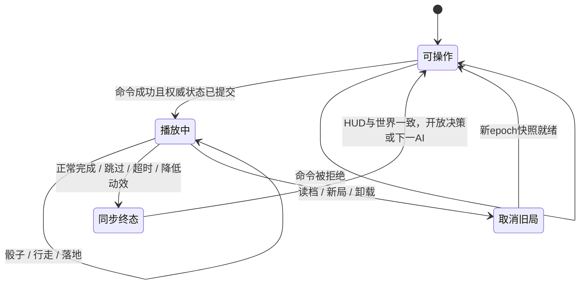

# 04 · 动画与回合演出

目标：玩家能把“我的决定、骰子结果、角色走过的路、经济后果”连成一条可理解的因果链。以下时长是初始调校值，需要真实试玩验证。

## 一个时钟，一次命令，一套权威结果

`applyAction` 只执行一次。演出规划器读取本次 `before/after/events`，输出纯数据片段：actorId、tileId、路径、金额解释、开始时间/持续时间、并行组和最终揭示点。播放器只改变姿态、声音和展示投影，不能发出规则命令。



片段有稳定 ID：`epoch:revision:eventIndex:cueIndex`。关键片段串行，脚步、气泡、镜头和身体动作可并行。每个命令最终都有一次幂等 `finishToSnapshot(after)`；不依赖某个模型的动画回调恰好触发才能解锁游戏。

## 正常投骰故事板

| 片段 | 初始时长 | 画面/声音 | 业务约束 |
| --- | ---: | --- | --- |
| 输入响应与起手 | 100～150 ms | 按钮反馈、人物短蓄力 | 当场锁定重复命令；校验失败不开始演出 |
| 掷骰与弹跳 | 550～700 ms | 一枚 3D 骰子翻滚、落地两次短弹跳 | 点数已由引擎决定；不另抽随机数 |
| 亮出点数 | 150～250 ms | 上表面停稳，旁边中文“掷出 N 点” | 点数不能被特效遮挡；遥控骰子有卡片提示 |
| 逐格行走 | 每格 140～200 ms | 转身、跑/走循环、脚步与路径标记 | 按真实路线和实际截停位置走 |
| 落地与结算 | 200～400 ms | 停步、目标高亮、金额/事件、表情 | 到揭示点统一切换 after 展示投影 |
| 决策/交接 | 立即可操作 | 购买、商店或下一回合 CTA | 不能提前显示下一角色的可提交操作 |

普通 1～6 格行动期望约 1.3～2.7 秒；默认步数卡导致的最长常规移动约 8 格，允许短暂接近 3 秒。复杂清算用一张可展开摘要表达，不逐笔播放十几个 400 ms 特效。整段普通行动设 3.2 秒软上限，5 秒 watchdog 失败恢复；超长自定义步数按规则计算完整路径语义，但用加速/分段摘要避免生成巨型帧队列。

## 骰子：结果驱动的演出

当前规则是一枚六面骰，`die_rolled.details.value` 是最终点数，`bonus` 是额外步数。画面显示“掷出 4 点，步数卡 +2 格”，不能将 6 格移动伪装成骰子掷出 6。遥控骰子沿用核心“即使遥控也消费原随机流”的规则，表现层不参与这项处理。

生产骰子有六个标定面法线和点数映射；资产检验验证 1～6 各面映射、相对面规则与最终画面可读性。最终姿态把对应面法线转向世界 +Y，再绕 Y 做小范围外观变化。相机从上方看清顶面，不把一个侧面的点数误当结果。

首轮采用六套终点已标定的关键帧/参数轨迹：上抛、旋转、衰减弹跳、落稳。最后一段在落稳前连续收敛至目标四元数，最后一帧只做数值校正，不允许先停成别的点数再突然翻面。可从命令 ID 派生**独立外观种子**改变抛掷方向，绝不读取/推进 `GameState.randomState`。

DiceView 位于不挡地块的固定演出区域，可由同一个 Canvas 的独立小视口呈现；不让随机骰子滚出屏幕。物理效果是可控的动画，不需要求解刚体碰撞；将来若用物理做装饰弹跳，结果仍由引擎给定且必须按时收束，不能让物理改变输赢。

快速/减少动态效果模式直接显示静止的正确面与文字，再继续揭示结果。命令拒绝、没有投骰的银行操作等，不能凭空播放骰子。

## 行走：道路路径与角色姿态分工

### 路径恢复

现有核心移动事件只有 `from/to`。当前单环下，优先用同批 `die_rolled.value + bonus` 得到原定步数，从 `before` 出发沿 `map.route` 枚举；出现 `roadblock_triggered` 时在引擎报告的触发格截断。验证最后节点等于 `player_moved.to` 和 after 位置。**不能只用“找到起点到终点的最短前向路径”**，因为走满一圈会回原位。

演出规划器测试覆盖：跨起点、零位移但走完一圈、额外步数、途中路障、拘留跳过、破产后换人。现有医院/监狱是落格停留，没有凭空传送；将来真的增加传送或倒退时必须提供明确移动语义，不借用环线行走推断。无法证实路径时，记录问题并直接展示终态，宁可降级也不编造经过的格子。

用逻辑节点序列选择 `SceneDefinition.routeEdges`。连续位置由每条边的路面控制点和弧长决定，转角不能直接穿过房屋。极长步数使用紧凑的“起点+步数+截停信息”表示，限定视觉采样量，不能按几十万步创建同等数量对象。

### 角色层级与动画

```text
ActorRoot                # 世界位置 + 地面朝向，只由路径播放器控制
  VisualBody             # 身体轻微起伏/倾斜
    Rig / Mesh           # 骨骼与模型，播放原地动作
  GroundMarker           # 编号、身份与当前行动标记
```

首轮使用原地 walk 动作，禁用会改变 ActorRoot 的 root motion。世界位移来自路线，脚步循环按移动距离同步；不是每走一格把整个人瞬移一次。转向用下一段切线和短四元数插值，约 80～120 ms，走路期间自然过渡，不在路口原地做完整转身表演。

`Idle → Anticipate → Walk → Arrive → React → Idle`。走/跑两套动作不同时作为首轮必需；先做好一套能按速度缩放的走路。多人同格时沿主路走到锚点，再在落地片段移向稳定站位；其余玩家站位只做短调整，绝不改变实际 position。

### 首轮动作表

| 动作 | 表达 | 是否循环 | 最小制作方式 |
| --- | --- | --- | --- |
| Idle | 呼吸/偶尔看周围 | 是，停稳时低频 | 程序微动 + 眨眼 |
| Walk | 有重心的迈步 | 是 | 共用骨架原地 clip |
| Roll | 抛骰蓄力与放手 | 否 | 上身 clip，可与骰子并行 |
| Happy | 买地/收入后的短喜悦 | 否 | 一个共享正向反应 |
| Hurt | 付租/受卡片影响 | 否 | 一个共享负向反应 |
| Defeat / Win | 破产/胜出 | 否 | 首切片复用反应+姿态，正式版独立制作 |

动作不乘八/十六个方向；转向由 3D 根节点完成。相同骨架可复用动作，但夸张体型需要检查脚底、手部和配件穿插，不能默认所有物种零成本复用。

## 经营与事件演出

- **买地**：产权旗和地基标记出现、小屋短升起/落稳、买家点头。现金变化与产权都在同一揭示点可见。
- **升级**：旧楼短压缩/淡出，新楼模块以 250～450 ms 出现；仍有清楚等级差。升完恢复正确碰撞/拾取体，不能只有“等级 +1”文字变化。
- **收租**：角色停步→地块和房东身份高亮→一条短金币流/金额→付款者受挫、房东开心。现金扣减与收入只由核心决定；金额标明付款人、收款人和实际支付值。
- **清算/破产**：显示“变现资产／支付租金／剩余状态”的摘要，产权释放同步到 after；不通过慢慢改 HUD 的数值模拟规则计算。胜负揭示等待当前事件完成。
- **卡片**：卡面出现 150～250 ms，明确目标，再播放对应效果；放路障需目标轮廓、合法性与确认动作。释放后实体留在规则指定格，触发时消失并截停角色。
- **医院/监狱/商店**：进入格后靠近该格入口，不擅自移动到别的规则格。拘留状态保留在角色/HUD；跳过回合是短状态提示，不播放行走。
- **银行/股票/贷款**：以 DOM 交易确认、数值更新和短反馈为主；不为每次存取款强制长镜头。复杂账户表格仍可键盘操作。
- **音效**：骰子碰撞、脚步落足、金币、建筑完成各绑定片段时间；seek/skip 不追赶播放所有漏过的声音。一个 cueId 最多触发一次，切后台暂停音频，新局销毁旧源。

## 速度、后台与恢复

| 情形 | 处理 | 必须维持的结果 |
| --- | --- | --- |
| 普通模式 | 关键片段串行，AI 等演出屏障 | 每次行动因果清楚 |
| 快速模式 | 缩短骰子/移动，单行动目标 0.2～0.5 秒 | 完整显示关键结果；帧率不决定 AI 策略 |
| 关闭/减少动效 | 同步终态 + 简短中文摘要 | 无旋转/弹跳/运镜，仍有合法 CTA |
| 点击跳过 | 当前事务一次性同步 after，清理 cue | 不重执行规则、不额外随机、不漏解锁 |
| 页面隐藏 | 同步当前已提交终态并保存，暂停后续 AI | 后台不继续跑几十个不可见回合 |
| 回到前台 | 显示已保存终态与最近结果，再继续 | 不补播所有过去片段 |
| 读档/新局 | 递增 epoch，取消旧片段/请求/AI；同步新局 | 旧异步回调不能改新局 |
| 模型丢失/context lost | 终态同步，暂停或简化显示 | 保住存档与下一步合法操作 |
| 播放器异常/超过 5 秒 | watchdog 记录原因并 finishToSnapshot | 动画不能永久锁死游戏 |

播放器用一个单调时钟，传入经过暂停处理的时间。长帧越过多个片段时按语义完成它们，声音最多播放当前必要提示，状态揭示幂等。自动化允许注入 fake clock 精确采样；生产不能依赖 CI 手动推进时钟。

## 必测不变量

同一初始存档和命令序列，普通/快速/关闭/中途跳过/后台切换后，最终 GameState（包括随机状态与 revision）必须完全一致。差别只能是等待时间、姿态与声音。对骰子 1～6 逐个验证最终面向；对所有关键移动和事件验证终态、队列释放与下一步可操作。

浏览器测试还要证明角色确实经历中间世界位置、骰子确实出现正确面、脚步与目标没有穿过建筑。只检查文本变化、只有动画数据单测或只播放一段录像，都不能算完成。
