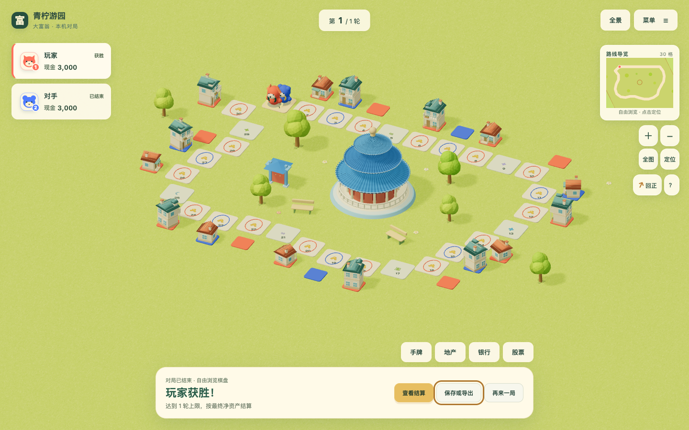

# 后台代玩公平性与终局自由浏览

2026-10-22，基线 `dev@9e12a7312d6541af482e5f4c9adffbbaf5254a1e`。来源为所有者对几十轮模拟偏向电脑、终局模态遮挡的反馈；[P012](../proposals/P012-local-debug-tools.md) / [#134](https://github.com/SiliconYC/ReactMono/issues/134)。

## 发现与修复

旧调试工具给真人使用基础行动器、给电脑使用已选策略。两者对建设、金融和资金保留的决策不同，不能用这种代玩差异判断经济数值是否公平。现在真人和未指定风格的旧电脑均用平衡策略；电脑显式指定的谨慎、平衡、进取风格仍有效。决策视图不写回玩家身份，不改变正常游玩的电脑逻辑。

终局去掉自动出现的全屏模态层，在普通底部栏显示赢家与结束原因。棋盘继续支持平移、旋转、缩放、地块和资产查看，不能继续执行回合操作。「查看结算」主动打开详细排名，可关闭；存档、导出和重新开局继续可用。后台模拟直接到终局时，原调试窗口自动关闭，直接展示最终局面。

[手机终局](evidence/rounds-phone.png) / [真实 Worker 模拟完成后的终局](evidence/worker-desktop.png)。截图来自生产静态页面，不是设计稿。

## 数值对照

两图分别测试双方现金 3000 和双方现金 100 万、40 轮上限。每组使用界面默认种子、连续种子 1～16、64 个由固定文本经散列生成的分散种子；每个种子有旧策略与换位、双方基础、双方平衡、实际调试入口五种模式。改前改后共 3240 条带模式标签的模拟记录，不能称作 3240 个独立种子。

下表只统计每组 64 个分散种子，电脑为第二席，双方初始资金相同：

| 地图 | 双方初始现金 | 旧调试电脑获胜 | 修复后电脑获胜 |
| --- | --- | --- | --- |
| 晴湾花园 | 3000 | 46 / 64 | 32 / 64 |
| 青柠游园 | 3000 | 48 / 64 | 27 / 64 |
| 晴湾花园 | 100 万 | 0 / 64 | 37 / 64 |
| 青柠游园 | 100 万 | 0 / 64 | 26 / 64 |

这些记录全部因 `round_limit` 结束，没有破产终局。所谓“40 轮就分胜负”，在本条件下是正常触发原轮数上限，按净资产结算；终局栏现在明确说明原因。相同存档、相同种子重跑仍为同一确定结果，调试窗口也给出提示。

同资金 100 万的旧策略控制组反而全部偏向真人，未复现“无论 100 万也都是电脑赢”。基础策略第一轮会连续执行约 997 次小额存款，使大部分资金尽早复利；平衡策略每个回合限制金融操作类别。差异来自持仓决策与存入时机，银行仍按整轮结息，不能解释为每次存款都会加息。没有用户当时的原始存档，不能把受控试验的条件当作用户原局条件。

324 条改前实际调试终态与冻结旧策略结果相符；324 条改后实际调试终态、动作数和逐动作散列均与双方平衡控制组相符。身份换位和旧无风格电脑的回归验证防止再按真人身份选择弱代玩。

## 证据与复现

- [对照摘要](evidence/comparison.json)与[原始字节散列](evidence/provenance.json)。
- [改前原始记录](evidence/baseline-raw.json.gz)、[改前缺测标注版](evidence/baseline-annotated.json.gz)、[改后记录](evidence/fixed.json.gz)，解压后为完整的逐局指标，未包含逐动作明文轨迹。
- 改前原始 `actual-debug` 没有采集动作分类，其汇总 `totalDeposits: [0, 0]` 表示缺测，不能当作真实零次存款。标注版改为 `null`；存款分析使用已核对经济终态与动作总数相同的冻结旧策略记录。原始字节另行保留。
- 在已构建工作区运行 `node scripts/debug-simulation-fairness.mjs <新标签>`；脚本拒绝覆盖已有标签，结果在 `artifacts/simulation-fairness/`。旧模式冻结选择规则，当前模式实际调用生产调试入口；可复现改前经济结果与改后结果，但当前脚本不会伪称重新运行旧版本入口。

## 验证与失败记录

- `npm test`：213 / 213，含角色换位、旧无风格电脑、按动作核对与存档往返；原电脑策略测试保留。
- 调试浏览器：六图桌面及青柠手机 7 场景，现金、实际后台模拟、完整状态、人工接续与离线新建 `Worker` 通过。
- 终局浏览器：桌面与手机各覆盖轮数结算、破产、平局、实际结束回合、实际 `Worker` 终局，共 10 场景。默认无打开模态、画布可命中，旋转缩放及主动排名/资产查看通过；导出前后完整状态不变。
- 主程序完整功能与两图四人完整局、正常/快速等价、文件存档与离线恢复通过；导航边界与运行时结果见同目录原始日志。
- 既有音效、节点回收、模态和闲置停绘、人机人交接、完整电脑局、双版本离线更新完整复验通过，原固定等待断言未变。两处本地服务均返回 `HTTP 200`；4173 实际点击投骰并进入 `await_decision`，保持服务运行。
- 演示构建与 7 个地图容器校验通过。独立代码审查及 22 项相关测试未发现阻断问题；提出的“模拟终局仍保留调试模态”已用真实 `Worker` 先复现失败，再修复并通过双视口验收。

初次终局测试因旧全屏层失败，真实 `Worker` 补验因调试模态仍打开失败，原始失败分别保留。既有运行时检查还曾在固定等待 650 毫秒后音频节点尚未全部回收，保留原断言与失败，不删除或放宽门槛；完整复验结果随日志记录。

最终再次执行量化脚本的 1620 条记录与此前改后记录逐项相等，见 `benchmark-recheck.json`，重复的确定性记录不追加为新的独立样本。

## 边界与回滚

有限种子和当前策略不能证明所有地图、资金、人数与真人选择都已平衡，也没有强行设定 50% 胜率。价格、租金、利率、随机数、轮数上限、关卡美术与地图容器均未修改；已有合法终局和存档不重算。后台后续决策改变是预期修复，正常人工对局经济规则不变。

回滚调试决策函数及界面提示可恢复旧代玩；回滚终局组件、界面接入和样式可恢复旧结算。无存档迁移、后端或外部素材。集成并同步 `dev`，使用 `[skip actions]` 避免自动正式发布；本轮远端 `CI` 未运行。主程序 4174 与迁移演示 4173 保持运行；物理手机、真人体验及正式版 #73 不在本轮完成范围。
