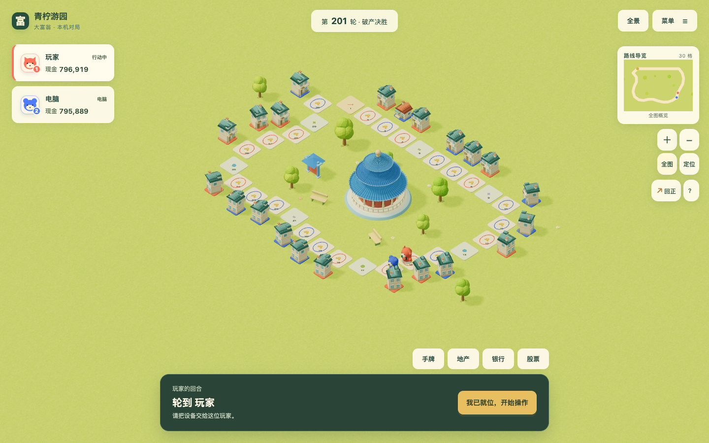

# 破产决胜、长局经营与账本边界验收

2026-10-22，基线 `dev@e1ec9ae`。来源为所有者的百万资金／200轮截图与租金、破产怀疑；[P005](../proposals/P005-classic-mechanics.md) / [P012](../proposals/P012-local-debug-tools.md) / [#135](https://github.com/SiliconYC/ReactMono/issues/135)。本次是对上轮只纠正策略身份差异的补充，不能用上轮通过的对照测试替代本次真实输入和长局验收。

## 截图的精确复现

青柠游园、界面默认种子 `20261015`、关闭特殊设施，以原始 2200 资金推进 200 轮，得到第 36 轮结束，玩家／电脑现金 263／409、位置 20／14、11 块产权、仅 1 栋房屋，与所有者截图一致。原调试界面的金额只是草稿，未点击逐人「设置」时，「一键模拟」会忽略它。这个交互使玩家以为双方已有 100 万，实际仍使用原开局金额。

同时，青柠关卡默认的 `maxRounds=36` 会强制按净资产结算。上轮明确保留此规则，但它不符合这次所有者要求的破产决胜目标。单纯统一代玩策略没有解决这两层问题。

## 实际改变

- 新主程序对局默认「破产决胜」，不因地图的 36／60 轮设置结束；轮次只继续累加，最后一位未破产玩家获胜。「限轮结算」保留为明确可选模式，填写限轮数量会选用该模式。
- 结束条件以可选 `endCondition: 'bankruptcy'` 保存在对局中。没有该字段的旧存档仍按原限轮规则运行；未结束的旧局可在调试工具中显式切换。已经结束的旧局不自动复活，新开局使用新默认。
- 「一键模拟」会把当前金额草稿与结束方式一起用于独立计算快照，全部成功后才替换原局。任一金额非法则不启动计算；取消、后台出错或过期回包不提交金额或局面。逐人「设置」仍可单独立即生效，界面明确显示已生效现金和存款。
- 电脑从已有存款筹备当前合法升级与后续可承担购地的现金预算。仍只能在规则允许阶段取款，保留各风格储备、同回合存取互斥及每次到访一次建设的限制。现金买股和存款不能花掉已筹备的经营预算，满额银行不再生成非法存款动作。
- 新局准备中原来写死的「每人 1500」改为所选地图的真实初始金额，结果栏、轮次与帮助区分两种结束方式。

没有直接给地图填房子。模型、地块设计、价格、租金和利率比例均未改动，房屋仍由真实购买与到访升级生成。

## 真实百万资金200轮

桌面与手机都从新局默认破产决胜开始，仅在调试框输入双方 `1000000` 与 `200`，不逐人点「设置」。实际创建生产 `Worker`，最终到第 201 轮开始，仍进行中；青柠 22 块可购地产全部已购买并建房，其中 21 块二级、1 块一级。玩家／电脑现金 796919／795889，银行存款各 634658，其他持仓另列在资产面板，资金没有凭空消失。

[手机实际画面](long-evidence/long-phone.png) / [双视口报告](long-evidence/browser-report.json)。取消、非法输入、超过现有事件容量导致真实后台失败时，完整原局不变；断网重载恢复完整最终状态；旧限轮局通过界面切换后可越过原上限。

默认资金同一种子的经营对照：

| 场景 | 修复前 | 修复后 |
| --- | --- | --- |
| 青柠 2200 资金，36 轮累计购地／升级 | 11／1 | 16／9 |
| 36 轮玩家／电脑现金 | 263／409 | 335／403 |
| 36 轮玩家／电脑存款 | 1038／1011 | 12／2 |
| 取消限轮，最多观察 200 轮 | 第 172 轮破产结束 | 第 117 轮破产结束 |

这说明已有资金真正进入经营，不能由一个种子的胜负或结束速度推导全局平衡。

## 算钱审计与修复

普通金额下没有复现“钱不够就拒扣租金、永不破产”。40 项独立账本边界覆盖现金零、差 1、恰好够、多 1，银行精确补款，股票手续费与清算顺序，土地回售与升级，抵押先偿银行贷款后付租，免租／零租金，2～4 人淘汰与跨轮结息，以及大额交易。实际不足时部分支付现有资金，依次动用存款、股票、可清算地产／抵押余款，仍不足才破产；付清后恰好为零不等于破产。

确认并修复的金额缺陷如下：

| 边界 | 原问题 | 修复 |
| --- | --- | --- |
| 房东现金 `999999999999` 再收租 120 | 规则收款成功，但超过单钱包 `1e12` 存档上限 | 现金允许多个钱包合流，存档与运行时检查一致，不截租金 |
| 现金 `1e12-1`、股票净额 79、租金 `1e12` | 强制卖股被错误现金上限阻止 | 完成卖股与支付，剩余现金 78，正常存档 |
| 存活玩家银行满额，另一玩家破产跨轮 | 结息抛异常，破产无法落地 | 银行仍限 `1e12`，实际利息按剩余容量发放并记录；只剩 1 容量就记 1，无容量不记正利息 |
| 大额股票部分卖出成本分摊 | 中间乘法越安全整数，成本少分摊 1 | 用商与余数分解，保持精确整数计算 |

统一金额检查要求所有玩家现金、存款、股票市值、已持有地产及升级的总毛资产不超过 `Number.MAX_SAFE_INTEGER`，债务另行检查；这样个人与全局净资产均可精确表示。极端导入或新收益超过该数值范围会明确失败、保留原态，不伪造付款成功。银行和调试输入继续限 `1e12`。这不是无限精度财务系统。

## 批量与回归证据

- `npm test`：266／266，保留既有 213 项，增加 40 项账本、7 项经营现金、6 项结束条件／草稿／路障测试。
- [264 局长局报告](long-evidence/audit.json.gz)：两图、各自默认资金与 100 万、2／4 席、界面默认种子加 32 个散列分散种子，最多观察 200 轮。381310 个动作逐项核对现金＋存款变化与真实事件中的外部流入／支出；全部精确相符，所有最终状态完整存档往返。
- 264 局中 95 局因破产结束，169 局到达观察轮数仍进行；百万资金的 132 局全部仍进行，没有伪造赢家或为了让测试结束而扣掉玩家资金。
- 既有电脑测试仍含 1000 局、248036 动作、零非法动作；另有三风格、两股票账户、四种子的 24 局长局检查，16154 动作、零拒绝。唯一调整的旧股票夹具改为现金足够经营，继续验证股票使用存款账户，并补充零存款不买股。
- 主程序完整功能、两图四人正常／快速状态等价、调试全地图与手机离线、终局自由浏览、运行时及存档回归的真实日志随证据保留；主／演示构建与 7 图容器校验通过。
- 独立审查找出破产模式路障期限仍按旧轮数校验、银行满额时策略仍存款两项漏项，均先复现失败再补回归修复；两项复核通过。

首次批量审计因合法路障无法保存失败，该缺陷另有最小红绿回归留证；首次浏览器长局已完成资金和200轮验证，但离线驱动用精确按钮名漏匹配「继续游戏 →」，修正测试驱动后通过，没有为此修改产品。既有运行时回归也出现固定等待650毫秒后音频节点尚未全部结束的失败，保留原断言与失败记录，不删除或放宽门槛。原始红绿、完整测试及审计数据保存在 `long-evidence/`。

## 边界与回滚

本轮修正真实流程、经营资金和账本边界，不宣称游戏已经达到成熟品质或整体经济平衡。给每人 100 万远高于数百元地产与租金量级，200 轮不破产并不异常；当前利率下财富还会增长。该压力场景用于检查持续经营和账目，不能替代正常资金下的趣味性、金融参数与长期对抗评估。

破产模式不按旧轮数判胜，但本地存档仍有 10000 条事件与安全整数容量；过大的批量计算会明确失败保留原局，本轮没有删除历史来绕过限制。200 轮双视口及 2／4 席批量样本已实际验收，不声称无限历史容量。

所有地图容器和美术均不变。旧存档继续可读；使用新可选字段的对局需由本版本读取。回滚结束条件、策略与金额模块即可恢复基线，无外部服务或付费资源。集成并同步 `dev`，提交使用 `[skip actions]` 避免自动正式发布；本轮远端 `CI` 未执行，`#73` 继续开放。4174 主程序与 4173 演示服务保留供继续试玩。
