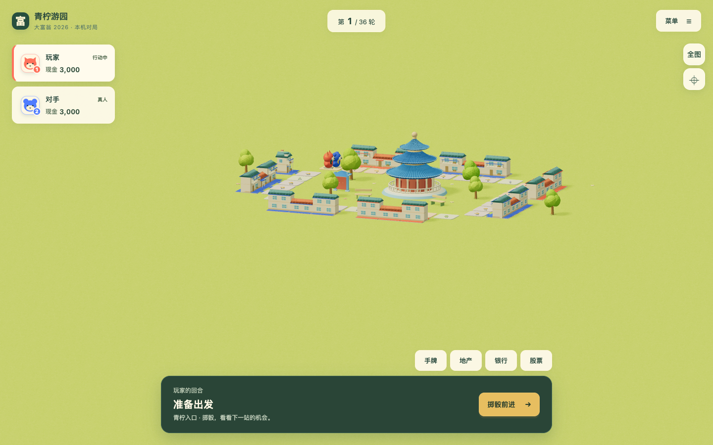

# 大富翁 2026 系统交互修整验收

后续所有者反馈已修正四秒资产窗口、住宅固有倾向色和中键接管；当前行为见[掷骰流程与住宅归属修正](landing-and-ownership.md)。以下保留为上轮历史验收。

2026-10-22，基线 `7cbab7c`，关联 [#137](https://github.com/SiliconYC/ReactMono/issues/137)。[设计与实施账本](design.md)逐项登记所有者反馈。共享修正作用于全部关卡，建筑细化针对青柠游园；没有改变地图数据、经济规则或存档结构。

## 对反馈的实际回应

| 反馈 | 交付行为与验证 |
| --- | --- |
| 掷骰/落地/购地/建设后跳切 | 删除演出强制跟随，底部采用固定安全预算，人物全程使用同一座位偏移。双视口真实掷骰、购地和联排建设逐帧检查全景模式不变、缩放误差小于 `0.03`、中心误差小于 `0.01`，安全区完全一致 |
| 视角限制 | 俯仰支持 `12°–82°`；按真实视角计算裁剪、地面覆盖和阴影相机，数字变形限制在路砖内 |
| 平面交替闪烁 | 共墙侧墙/饰板/窗框/玻璃原先在 `x=±1` 四层共面；移除不合理的共墙侧窗，窗格交叉真实错开 `4mm`，保留统一投影受影，不以关阴影掩盖 |
| 主人辨识度 | 原色主体和屋顶保留，只将门楣、遮棚、檐带和扶手作为业主饰件单独实例化；有实际归属色与几何回归 |
| 初始化朝向 | 根据所在路砖通向下一格的世界方向初始化，移动朝向采用最短角插值。七图规则位置测试及真实模拟 `30` 轮后读档检查通过 |
| 长按土地/房屋 | 静止按住约 `400ms` 显示价格、产权、等级、街区和通行费；短击无常驻层，松手即消失，拖动或取消不迟到弹出 |
| 长按角色 | 显示姓名、真人/电脑、现金、存款、贷款、地产数量和位置/特殊状态；按住 `I` 有键盘等价入口，松开即隐藏 |
| 游戏名称 | 网页标题、首页、页脚、PWA 和公共界面使用“大富翁 2026”，保留晴湾等真实地图名 |
| 多余结束点击 | 真实演出结束后 `4` 秒自动继续；建设/商店仍等待选择。“管理资产”锁住当前回合，经营后主动继续；加载旧结算状态仍可明确继续 |
| 中键拖动 | 按住中键与 `Shift＋左键` 都旋转，旋转冻结缩放；滚轮仍缩放。双视口实际中键和滚轮断言通过 |
| 路砖椭圆 | 青柠产权圈删除，改为路砖 `22%` 混入业主色，选中状态继续可辨 |
| 右上控件 | 默认仅显示视图切换与地图工具，移除顶部重复全景/跟随；小地图、缩放、回正和说明收纳在展开面板，展开不重新取景 |

[手机低角度](evidence/low-angle-phone.png) / [按住角色](evidence/actor-tooltip-desktop.png) / [手机地块提示](evidence/land-tooltip-phone.png)。均为本地生产静态页面实拍，没有用图片代替游戏。

## 自动衔接与输入边界

自动继续只对本局实际行动后已完成决策的真人结算状态启用；计时器核对同一局面对象、玩家/轮次及实时门槛。建设、移动、租金、胜负、真人交接、调试、存储、隐藏页、弹窗、按住提示和右键菜单都会阻止交接；管理资产则保持人工继续。旧局回调不能作用于新建或读入的相同编号局面。

长按优先区分角色与地产，实例房屋仍保留所属地块。位移超过 `7px`、多指、释放、取消及失焦会清理按住意图；真实手机视口经原生触屏协议检查按住、多指取消和 `touchCancel`，并非只发鼠标事件。右键菜单依然可浏览地图，但不再生成需要手动关闭的常驻地块小窗。

## 实际验证

| 检查 | 结果 |
| --- | --- |
| `npm test` | `295/295` 通过；新增朝向、低角度足迹、长按取消、命中归属、业主饰件/真实共面及自动衔接边界 |
| 构建与地图 | 生产构建、独立 demo 构建及七图校验通过，demo 保留既有大包体积提示 |
| 系统专项浏览器 | 桌面 `1440×900`、手机视口 `390×844`：相机连续帧、买地/联排后自动交接、经营锁、右键菜单暂停、地块/角色/键盘长按、原生多指取消、模拟后朝向及低角度均通过，错误数组为空 |
| 既有青柠浏览器 | 六项等级/动画/减少动态、九项联排建设/现金/租金/存档，以及双视口新局/导航/完整结算/存档通过 |
| 相机与大图 | `classic-24` / `ridges-360` 各桌面/手机四场景及建成屋顶命中通过；旋转缩放互斥、地砖编号矩阵、边缘菜单、双指和闲置 GPU 原断言保留 |
| 完整主程序验收 | 十组通过，包括骰点中间帧/输入屏障/跳过等价、金融/卡片/特殊状态、真人交接、租金破产胜利、双图四人正常/快进状态等价及离线 PWA |
| 界面 | 七视口加长姓名、巨大金额和 `200%` 等效视口通过；对话框模态隔离、焦点和金额断言保留 |
| 运行时 | 音效真实启动和节点回收、减少动态/模态 GPU 停绘、存档拒绝/覆盖、电脑完整局、人机人交接及双 SW 更新/断网检查通过 |
| 画面取景回归 | 晴湾美术 after 和生活街区 after 八组通过，保留历史旋转、中心、模式和局部缩放倍率，新预算逐道路投影检查通过 |
| 独立审查 | 相关输入/相机/回合 `14/14`；发现右键菜单未暂停自动继续的 P2，真实浏览器先复现，再合并场景交互 busy 并验证修复 |

日志、JSON 与截图见 `evidence/`，日志归档只清理行尾空白。额外迁移的 `debug_tools`、`demo3d`、`living_runtime`、`long_economy`、`postgame`、`scalable_world`、`stress_maps`、`navigation_edges`、`world_populated` 本轮只做语法检查，未声称全部浏览器运行通过。

## 验收契约迁移与失败记录

- 旧“一击后常驻详情”改为真实按住/松手检查，保留原土地名称、屋顶归属和实际命中的断言；旧“结束当前回合”改为等待自动交接或管理后继续，保留完整局、现金、产权和存档等价检查。
- 全图/跟随按钮按当前模式复用，测试通过明确设置目标模式和展开工具操作，不依赖旧按钮堆叠。手机双指测试曾误落在已展开工具面板；采集命中元素后修正输入位置，原缩放断言未放宽。
- 历史美术 before 的动态 HUD 取景与本次固定预算不能宣称逐像素同机位。继续比较方位、俯仰、中心和模式；新增 `230/278` 像素预算、实际全景道路安全区、近景倍率断言，明确记录有意改变的构图规则。
- 独立审查的右键菜单问题在生产浏览器确实从 `await_end_turn` 变成 `await_roll`，失败记录为 `context-red.log`；修正后菜单打开超过四秒不交接，关闭后自动恢复。
- 首次专项驱动未关闭资产弹窗，并精确匹配遗漏箭头的继续按钮；按真实 UI 修正驱动，不为测试新增兼容按钮。
- 一次并发运行的音频节点固定等待检查失败，保留 `runtime-first-failure.log`。增加实际计数诊断后，同一等待和相等断言原样重跑通过；未修改音效实现或放宽断言。该测试仍存在时间敏感性，不把一次重跑解释为已定位音频根因。

## 研究与限制

既有上游研究仅作为设计参考，没有复制代码或商业资源。镜头“局部动作不应覆盖独立运行时参数”的通用结论与 [Agora 既有文档](https://github.com/SiliconYC/agora/blob/dev/docs/practices/single-variable-viewer-state.md)重复，按 `agora-create-wiki` 查重后不另建重复条目；本轮只保存自己的实测证据。

本轮没有物理手机或真人长期体验结论，不宣称像素级全场景零伪影或 P4 正式版完成。前端运行规则和存档结构未改；回滚本轮实现提交即可恢复旧输入/镜头/UI。集成目标为 `dev`，使用 `[skip actions]` 避免正式发布，主程序 `http://127.0.0.1:23010/` 保持运行。
