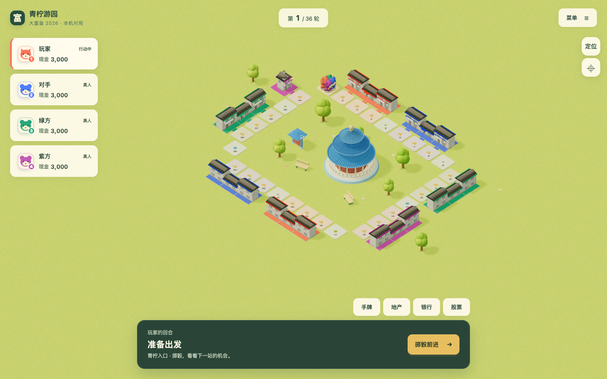

# 掷骰流程与住宅归属配色修正

2026-10-22，基线 `4c0a57a`，关联 [#138](https://github.com/SiliconYC/ReactMono/issues/138)。所有者否定上一轮掷骰后的四秒资产管理窗口和有色屋顶，明确撤销中键管理。本记录取代[上轮验收](acceptance.md)中相应的产品行为结论，不改写历史证据。

## 实际变化

- 真人在掷骰前办理存取款、股票、抵押、借还款和出售地产；金融规则现在允许 `await_roll`，界面仅在此阶段开放交易。手牌原本就在掷骰前使用。旧不限到访规则允许在掷骰前经营房屋；新到访规则和青柠联排仍必须实际到访后建设。
- 掷骰后仅保留购地、到访建设、商店等落点决策。移除“管理资产”、手动继续和四秒倒计时，真实移动/结算/建设演出完成后直接交接。已结算旧存档也自动衔接，不再依赖只在当前界面产生的行动标记。主动菜单/模态、隐藏页和实际演出继续作为输入屏障，不新增经营询问。
- 核心仍接受原结算阶段金融命令，保护现有电脑策略和旧动作回放；不是把电脑经济策略悄悄切到另一套规则。金融金额、价格、利率、租金和存档格式不变。
- 游戏不再映射或阻止中键的默认行为。保留 `Shift＋左键` 旋转及滚轮缩放，同步更新帮助和无障碍说明。没有认定用户遇到的问题必然由 Chrome 导致，本轮直接按用户要求撤销接管。
- 青柠两级独栋/联排统一采用米白墙、灰褐屋顶和灰色窗面，主体顶点色的 sRGB HSL 饱和度不超过 `0.18`。业主饰件保持白色顶点，实例色沿座位原色相提高饱和度至至少 `0.8`，避免固有色相乘污染；新增前后连续檐带，饰件顶点量仍小于主体 `15%`。统一光照、阴影、几何分层及真实建设动画保留。其他地图美术及全部地图数据未改。

[手机视口实拍](followup-evidence/neutral-owners-phone.png)。这是实际主程序四玩家、两等级住宅画面，没有以图稿替代实现；饱和度与几何测试用于保护设计约束，不代表已获所有者视觉认可。

## 验证与契约迁移

- `npm test`：`298/298` 通过，包含七图/旧档既有测试及新增掷骰前金融交易、存档往返、零额外等待、落点选择保护、过期回调、中键不映射和中性底色/前后饰件约束。
- 生产构建、独立演示构建、七图校验通过。演示沿用既有包体积提示；没有正式部署。
- 系统专项浏览器在桌面 `1440×900` 与手机视口 `390×844` 验证真实掷骰/购地/联排建设、相机连续帧、掷骰前存款、旧结算档自动交接、没有管理/继续按钮、落点决策期间没有金融工具、中键事件不拦截、`Shift` 旋转和低角度、长按/原生触屏取消及模拟后朝向；错误数组为空。
- 完整主程序十组通过：金融真实命令、旧现金股票账户、到访与旧建设规则、五种手牌、医院/监狱/商店、破产胜利、主动菜单暂停、两图四人正常/快速完整局状态等价、离线 PWA 和导出恢复。金融样本改为掷骰前，保留原金额、手续费、抵押/借还和存档断言。
- 原建设/联排脚本在演出完成后等待真人交接，代替旧“保留当前回合”资产锁。保持等级、建设动画、现金、租金、减少动态与存档完整比较。
- 原相机测试中键改为不改变视角；第三次大角度输入使用 `Shift＋左键`，不降低 `yaw > 1.5` 的覆盖门槛。界面金融验收改为掷骰前存款，保留模态隔离、焦点、金额预览和触控尺寸断言。

原始日志、JSON 和截图在 `followup-evidence/`。本轮未运行所有历史浏览器脚本，不宣称全仓库所有端到端检查已执行。

## 失败与限制

新增测试先确认旧实现的中键映射、非中性底色、掷骰前拒绝存款以及四秒等待；首次测试还暴露缺失入口，调整为独立行为断言后再次记录。实现后发现两处验收迁移遗漏：存档返回的是信封而非 `ok` 标记，以及旧不限到访规则的掷骰前升级预期仍写成拒绝；按真实契约修正，新增到访模式仍拒绝的保护。相机脚本首跑仍累计了已撤销的中键转角，保留失败记录，改用足够长度的 `Shift` 拖动，不放宽角度门槛。

没有物理手机、跨浏览器中键功能或长期真人结论；不宣称所有浏览器的中键特性一致。无存档结构升级，回滚本轮提交可恢复旧交互；若回滚，新的掷骰前金融动作需要先结束当前阶段才能继续操作。集成目标 `dev`，提交使用 `[skip actions]` 避免正式发布；`#73` 仍保留。
