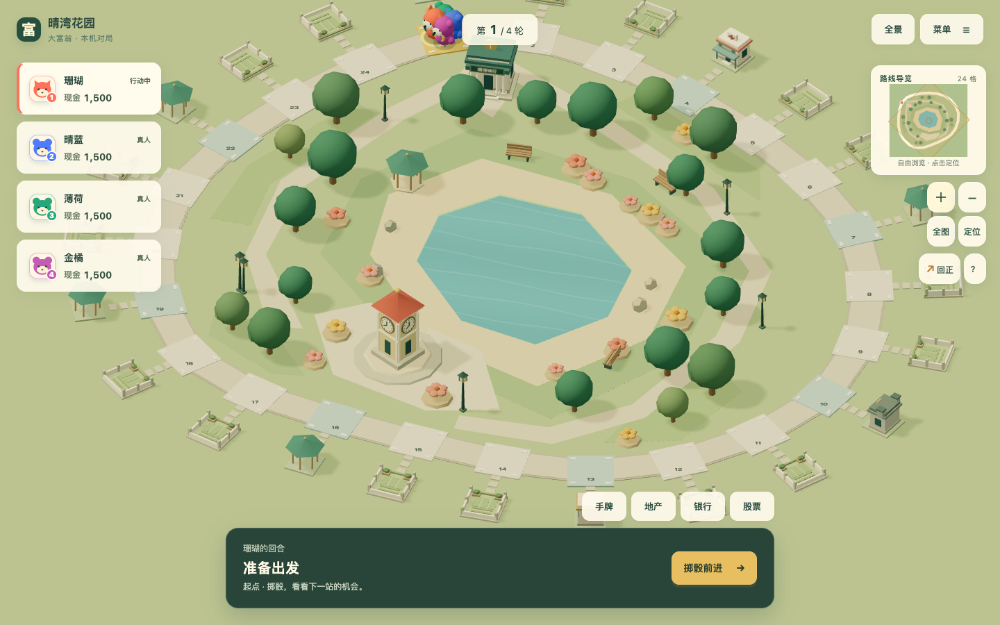
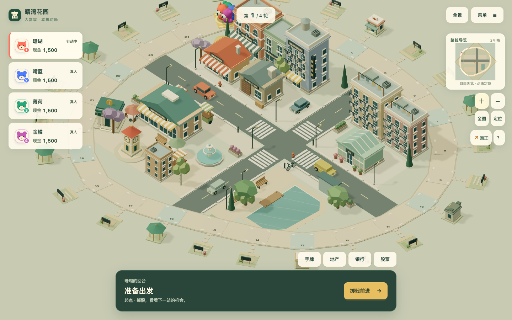
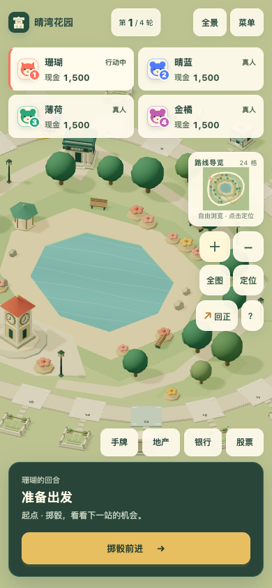
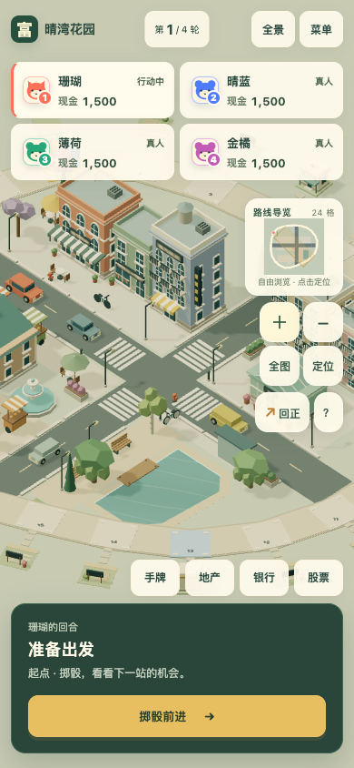

# 晴湾花园：从空地棋盘到生活街区

2026-10-22。来源为所有者对上轮视觉结果的否定与三张街区参考图，综合任务 [#129](https://github.com/SiliconYC/ReactMono/issues/129)、[PR #130](https://github.com/SiliconYC/ReactMono/pull/130)。起点为 `dev@5e9b041800010cb305f7828807fee8a896922d9a`。本轮集中重做 `classic-24` 的实际场景，其他五张地图不重新编排。

上轮工程验收通过，但所有者认为画面仍贫瘠、待售地像墓园；此前独立审查对整体提升的判断未得到用户认可。本轮不延用该品质结论，也不将模型数量或测试通过视为美术达标。

## 实际变化

保留原创低多边形、柔和暖墙、彩色屋顶、正交微缩比例和统一光照。在已有显式关卡系统内，将中心大草坪改为街道、建筑、市场广场与水岸的连续空间，新开局就有生活街区。

- 咖啡馆使用拱窗、分层檐口和条纹雨棚；旅店有四层立面、阳台和屋顶水箱；书店为窄面薄荷色门脸；面包房有较低坡顶、烟囱和橱窗。公寓、市场、工坊、温室分别具有阳台、双面拱廊、卷帘门与木材堆、玻璃肋架等独立轮廓。
- 建筑朝向街面与广场，较高体量布置在远侧，近侧留给市场、喷泉、钟楼和水岸。增加人行道、路缘、横道、车道标线、公交站、车辆、自行车、桌伞和摊车，形成具体用途，而非散点填景。
- 柏树、桦树、垂柳、紫花树采用不同树干和冠形；绿化围绕街角、座椅、庭院及水边布置。小水域与木栈台可见，避免水面被沙岸覆盖。
- 待售地改为薄铺地、开放步石及横向牌，不再使用白色围墙。零级仍为空地；住宅按地址区分六组门脸、屋顶与色板，一、二级通过楼层、阳台、山墙等成长。同业主联排改为有分段立面的住宅街面。
- 产权继续使用业主色地界、旗牌和等级点数；抵押保留红色封条与详情文字。高楼遮住当前角色时临时整体淡出，旋转离开遮挡后恢复，角色与动作系统未改。

银行、商店、医院、监狱沿用现有功能建筑。背景商业建筑仅为场景，不增加可到访经营、交通或其他规则。

## 真实主程序对比

基线来自上轮已经合并的实际版本，而非更早的简陋版本。新局使用 [正式新局存档](evidence/fresh-state.json)，已建局使用 [固定正式存档](evidence/town-state.json)，包含四业主、未购地、零级、一/二级、联排与抵押。固定样本经正式存档入口导入，不冒充自然养成进度。

[改前记录](evidence/living-before.json) 与 [改后记录](evidence/living-after.json) 核对存档哈希、视口、模式、安全区、中心、方位、俯仰和缩放。同一平台上严格比较；远端 CI 会重新构建同一旧提交并在同一 Linux runner 复拍两版。

桌面 `1440×900`，同一新局、同一中央街区镜头：

新局全景：[改前](evidence/before-fresh-desktop-overview.png)、[改后](evidence/after-fresh-desktop-overview.png)。旋转街景：[改前](evidence/before-fresh-desktop-district-rotated.png)、[改后](evidence/after-fresh-desktop-district-rotated.png)。

手机 Chromium 视口 `390×844`，同一新局、同一街区镜头：

已建局：[桌面全景](evidence/after-built-desktop-overview.png)、[桌面街区](evidence/after-built-desktop-district.png)、[手机街区](evidence/after-built-phone-district.png)。地产状态：[零级与一级](evidence/after-desktop-state-7.png)、[选中抵押](evidence/after-desktop-state-11.png)、[手机抵押](evidence/after-phone-state-11.png)。补充固定跟随视角的 [改前](evidence/before.json) / [改后](evidence/after.json) 数据同样保留。

## 功能、资源与兼容性

| 检查 | 实际结果与证据 |
| --- | --- |
| 构建和规则 | `npm test` 195/195；[日志](evidence/checks/node.log)。新增确定性模型、贴地、等级成长、开放空地、道路及同高铺地不重叠检查；未删旧测试 |
| 真实经营与完整对局 | 买地、建设、升级、出售、抵押、租金、银行/股票、卡片和设施、两图四人完整对局、正常/快速终态等价通过；[日志](evidence/checks/main-game.log) |
| 旧档、离线 | 旧现金股票账户、旧异地建设规则、文件往返、生产 PWA 断网重载与自动续局通过；同上日志 |
| 双视口画面 | 新局/已建各全景与街景共八组，另有旋转与产权近景；相机一致性断言通过，页面错误为空 |
| 六轮资源 | 同一 Canvas 双视口各六轮旋转、回正、概览与跟随，实际触发建筑淡出/恢复；几何 205、纹理 10、程序 17 均无累积；[数据](evidence/checks/cycles.json)、[日志](evidence/checks/cycles.log) |
| 原运行时检查 | 首次触发既有 Mac 音频固定 650ms 断言；保留 [失败](evidence/checks/runtime-first-failure.log)。附加音频时钟记录、相同等待及原断言的整套复验通过，三个振荡器全部结束；[诊断与结果](evidence/checks/runtime-audio-clock.log)、[原版独立重跑](evidence/checks/runtime-original-rerun.log)（该音频重跑为批次修复前，最终代码另经完整 CI 门槛） |
| 完整远端回归 | 原有 demo、七视口、镜头拾取、五图、360 格满建、导航、旧档、离线/双 SW 与新增街区检查全部保留，完整 CI 是合并门槛；最终运行与结论见关联 PR |

常驻透明层以更多预留几何换取切换稳定：修前 197 几何/11 纹理/23 程序，最终为 205/10/17。模型、三角形及绘制预算未删减。六轮资源数据来自正常动画的稳定跟随采样，桌面 303、手机 281 次绘制，仅说明该条件下的成本；减少动态画面中统计可能仍为零或上一镜头数值，不能据此声称固定近景提速。没有真机 GPU、持续热耗或真人审美满意度数据。

显式 SwiftShader 加四倍 CPU 限速，两个存档、两个视口、全景与街区八组画面及相机断言通过，页面错误为空；均实际选择 `efficient`（统一 1024 阴影与 0.65 像素比例）。[原始数据](evidence/efficient/living-after.json)、[桌面街景](evidence/efficient/after-fresh-desktop-district.png)、[手机街景](evidence/efficient/after-fresh-phone-district.png)、[日志](evidence/checks/efficient.log)。低档画面更软，小字与窗框损失细节；启动采样含初始化成本，不将这些间隔当持续帧率。原始几何和贴图来源、构建字节见 [资产清单](ASSETS.json)。

## 独立审查、失败与剩余缺口

独立只读审查确认新局形成真实商业街与市场公共空间，建筑体量、屋顶和树形明显多样，开放地产消除了围墙墓园感；核心规则及其他五图显式数据未变。发现的人行道与交通街道同高重叠已经拆分几何，并以几何测试和逐点核查复验。早期树与灯侵入路线、温室屋顶肋架水平、沙岸覆盖水面、联排长廊感和招牌字级也在实际画面中修正。

手机六轮资源首轮因旋转幅度不足、始终处于同一遮挡集合而失败；扩大实际旋转角度后，保留原资源和切换断言复验通过。没有把未覆盖当通过。音频时钟诊断的第一次工具脚本缺少语句分隔而未注入成功，修正的是临时诊断脚本，并非产品或原测试。

首次完整远端 CI 471 在点击“跳过演出”时按钮自然退场，后续测试未执行，不能视为通过；[原始失败](evidence/checks/ci471-first-failure.log)。同软件条件下旧版通过六种骰点，新版曾漏中间格。进一步追踪发现遮挡集合切换与重建尖峰重合：可变实例数量作为 React key，导致几何/材质重挂，透明层及图集还会冷创建。现为同一可见集的两层预留容量，仅更新有效数量和属性缓冲，共享图集并在场景就绪前预热；跨镜头分块仍可重建。没有降低模型细节、阴影预算或改变角色时间。[修前骰点4](evidence/checks/cutaway-before.log)、[修后骰点4](evidence/checks/cutaway-after.log) 是定向诊断，日志沿用了原阶段名称，但只筛选了骰点4，不能冒称全六种通过。

修后软件原套件先通过前八阶段，之后手机策略存档加载超时。发现先前验证电脑恢复的桌面页面仍以 `always` 持续绘制，与后续手机场景共用软件 GPU；现在保留恢复断言，再用公开菜单暂停旧页面并新增 `frameloop=never` 断言后运行手机检查。原 `20s` 就绪、`95s` 对局、全部中间格和终态条件保持不变；[隔离前失败](evidence/checks/software-background-failure.log)。原跳过检查新增失败输入追踪，截图样本哈希也补为自动断言。

首次隔离版立即读取 `frameloop`，在电脑刚恢复的演出过渡中误报；[原始记录](evidence/checks/software-isolation-race.log)。独立审查指出产品会等当前演出完成才停绘，现改为条件等待该属性，无产品改动，也没有增加原就绪或对局时限。软件分段诊断只证明对应阶段；[尾段复验](evidence/checks/software-tail.log) 已通过电脑暂停恢复、两图完整局与离线，前八阶段结果保留在隔离前日志，不能合称同进程完整软件套件。最终代码已通过同进程原生完整套件；同一代码头的远端完整 CI 仍是合并门槛。

仍然存在以下美术缺口：

- 外环地产与内侧商业街仍有棋盘附属区观感，尚未成为全图连续的城市街巷。
- 遮挡时整栋建筑透明，牺牲部分立面辨识；这属于角色可见性的折衷。
- 手机全景主要用于导航，小招牌、窗框及产权点数需放大或查看详情；控件仍会覆盖局部画面。
- 所有建筑仍是程序低多边形模型，背面、室内、招牌细节和局部材质丰富度有限；场景车辆和店铺没有新增玩法。

本轮可以确认较上轮出现了可见的街区空间与模型差异，不能宣称已经达到参考图细节密度、成熟商业游戏全面品质或完成 `#73`。

## 重跑与回滚

`npm test` 后执行 `LIVING_PHASE=after python3 tests/browser_living_town_e2e.py`、`TOWN_PHASE=after TOWN_EVIDENCE_DIR=docs/living-town/evidence python3 tests/browser_town_art_e2e.py` 和 `python3 tests/browser_living_town_runtime_e2e.py`。不要在新代码上使用 `before` 覆盖旧图。CI 自动归档旧提交并复拍基线。

任务只面向 `dev`。所有者已授权 PR 验收后自主合并；合并提交使用 `[skip actions]` 阻止未授权的 Pages 发布，不改部署工作流。回滚本 PR 表现和关卡改动即可，不需要迁移或清空存档。主程序开发地址 `http://127.0.0.1:4174/`，迁移 demo 为 `http://127.0.0.1:4173/`。
