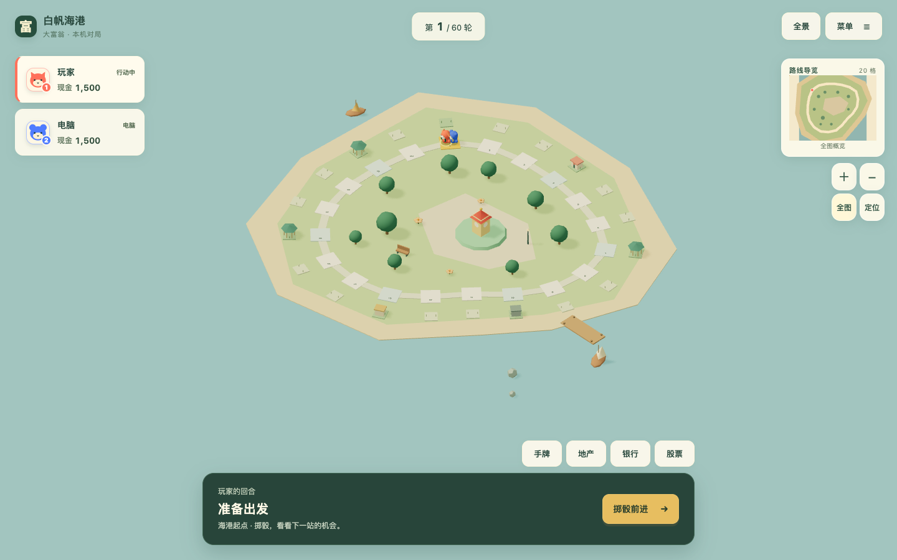
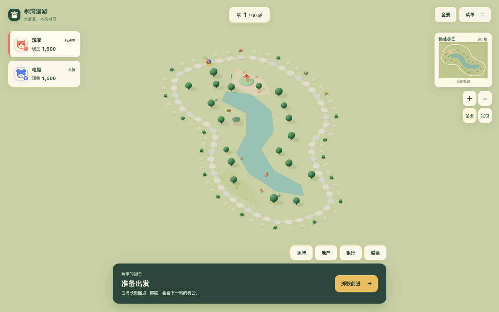
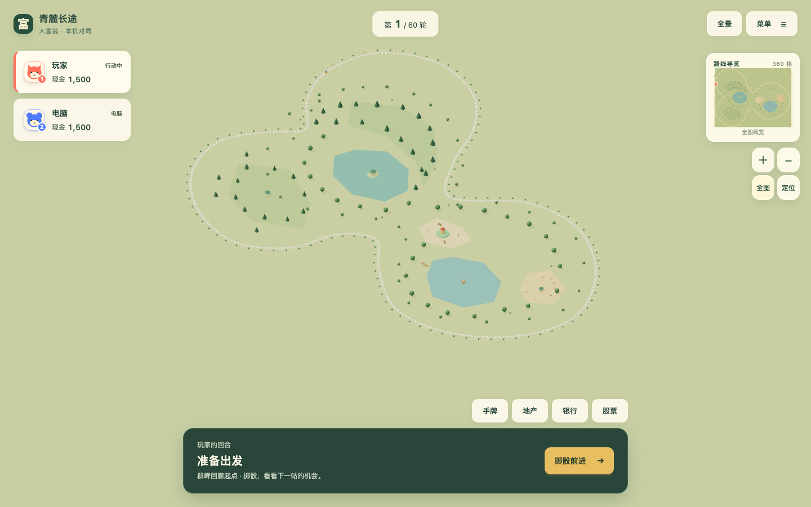
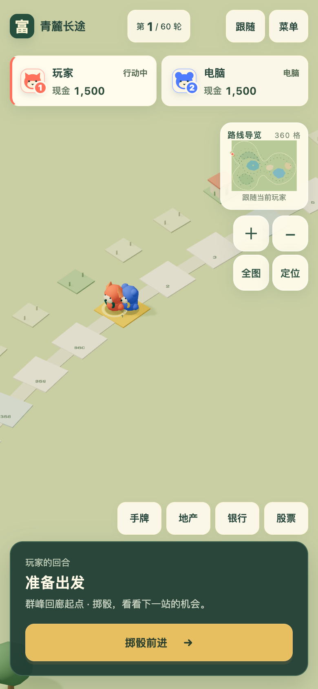

# P008 显式关卡世界与路线重绘验收

日期：2026-10-20（北京时间）。来源：[P008](../proposals/P008-authored-level-worlds.md)、[#118](https://github.com/SiliconYC/ReactMono/issues/118)。实现基线 `7401204`，画面与审查修复 `1086a2a`；后续提交只整理证据与文档。目标为本地 `dev`，未发布正式 Pages。

## 交付行为

关卡目录升级为版本2，新增一等 `world` 数据：基础地表、陆水轮廓及洞、每个路砖与地产的世界坐标、每株植物和每个设施的位置/朝向/尺度。运行时只绘制这些记录和做可见性/细节筛选，删除了坐标散列植被、自动中央钟楼与按中性格标题临时创建公园的逻辑。详细格式见[创作说明](README.md#显式世界格式worldversion--1)。

规则 `map`、地块经济、事件、卡片与设施参数全部保持原值，独立摘要测试锁定兼容基线。`world` 不进入 GameState 或存档，旧档加载后采用新表现。历史版本1规则草稿仍可校验；正式内置目录的每关均要求完整场景。

| 关卡 | 格数 | 地形面 | 显式景物记录 | 构图 |
| --- | ---: | ---: | ---: | --- |
| 晴湾花园 | 24 | 3 | 31 | 荷塘、沙岸、钟楼花街与缓弯 |
| 白帆海港 | 20 | 3 | 26 | 岸边环带、草地、码头、白帆 |
| 柳湾漫游 | 60 | 3 | 52 | 柳林、集市和沿河湾展开的街道 |
| 双湖水城 | 120 | 5 | 80 | 双湖、湖心洲、广场与回湾 |
| 青麓长途 | 360 | 7 | 239 | 山麓、湖城、牧场三个明显区域 |
| 内部方环 | 16 | 1 | 5 | 保留原坐标的迁移参考场景 |

道路与地产不再由规则方格决定外形。预览、小地图、棋子移动、道路点击和地产朝向使用同一份坐标；曲线街区联排按实际朝向、距离与足迹连接。医院/商店/监狱有明确设施模型。原全景/跟随/浏览、触控、清晰雾距及统一投影/受影继续工作。

## 已运行的验证

- `npm test`：**179/179**，包括真实规则模拟、存档往返、目录负例、规则摘要、任意朝向的路砖/地产/连接体占用和陆水支撑。完整输出：[Node](authored-evidence/node-tests.log)。
- `npm run demo:build`：通过；Vite 有单块超过1200kB的体积提示，未隐藏。主程序静态构建随 npm test 通过，同源运行依赖仍全部进入 PWA 缓存。
- 主目录及三个独立交换容器分别运行 `scripts/validate-maps.mjs`：通过。交换副本与主数据同步。
- `browser_scalable_world_e2e.py`：五图×桌面1440×900/DPR1、手机视口390×844/DPR2，**10组全部通过**。真实掷骰、全景与跟随、滚轮、拖动、键盘、三处远端小地图定位、手机双指缩放、旋转路砖射线点击和正确详情编号均通过，页面/控制台错误0。[原始指标](authored-evidence/world.json)、[日志](authored-evidence/world-browser.log)。
- `browser_world_populated_e2e.py`：通过正式存档入口加载360格满建对局（明确为压力夹具，非自然养成），桌面/手机各4次近景↔全景切换通过；近景纹理始终4张，几何数量未增长。[资源与帧数据](authored-evidence/populated.json)。
- `browser_world_navigation_edges.py`：减少动态下越界后GPU停止绘制、长按拖动不误选、跨图存档与大图远端平局回到全景均通过。[记录](authored-evidence/navigation.json)。
- `browser_ui_rebuild_e2e.py`：1440×900、1280×720、1920×1080、2560×1440、390×844、360×640、844×390七视口的准备、真实购地、存款、模态焦点通过；长姓名、大余额与200%等效视口检查通过。[日志](authored-evidence/ui-browser.log)。

原道路像素门槛（>94%）保持不变，360格最终桌面360/360、手机356/360；其余图仅起点的金色像素不符合浅色路砖检测。浏览器使用本机 Chrome / Apple M1 Metal；10组全景与移动帧样本 p95 均不超过16.8ms。这是本机短样本，不是物理手机或长时性能承诺。

## 独立审查与实际修复

独立审查发现旧联排仅接受轴对齐两单位地产，新路线使五图联排全部消失。已增加先失败的正式地图回归，再按门面夹角、实际连接OBB和道路/第三方地产占用修复；渲染连接体的长度、旋转和校验一致。复核19项针对测试通过，六图地形三角化面积等于外环减洞面积，没有剩余实质审查问题。

视觉迭代还修复：双湖内弯地产挤压；海港沙岸盖住草地（改显式环带）；亭台悬于水面（补显式湖心洲）；360与120轮廓过似（重绘三个区域）；旋转路砖数字越界；旧矩形包围盒浪费手机全景空间。最后一项保留原验收门槛，通过真实投影轮廓取景修复，而非放宽像素检查。

## 实际画面

其余截图同目录保留。以上是实际游戏、实际渲染器，不是效果稿。

## 验收边界

这是显式背景与显示体系的升级，仍使用简洁低多边形模型；没有将其宣称为完整商业美术验收。未改动经济平衡，也未新增真人趣味性研究、物理手机、长时运行或正式发布验收，#73继续开放。回滚本任务提交即可恢复P007表现，已有对局规则和存档不受影响。

本地入口最终检查：[4174主程序](http://127.0.0.1:4174/)可打开并进入五图选择，[4173迁移参考](http://127.0.0.1:4173/)实际掷骰后到达可购地状态，两者HTTP200且页面错误0；[记录](authored-evidence/local-entrypoints.json)。服务器继续运行。分支收口见 [PR #119](https://github.com/SiliconYC/ReactMono/pull/119)，目标dev。
