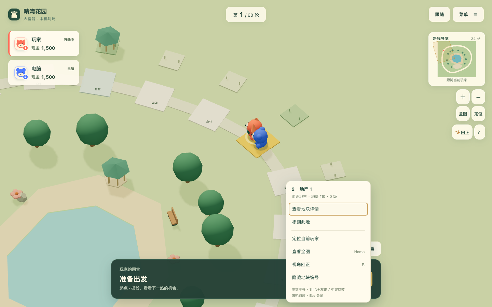
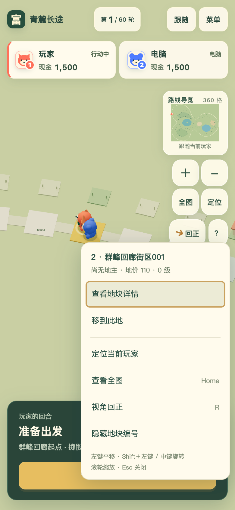
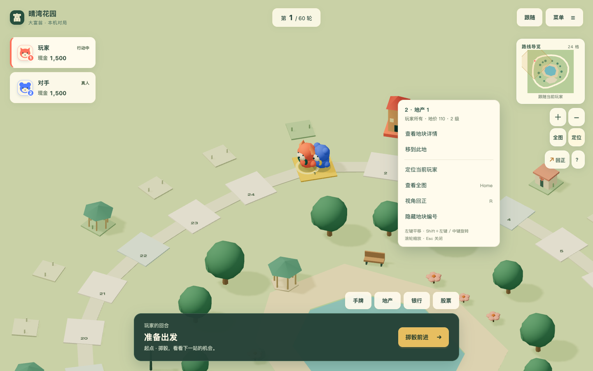

# 地图操作与旋转可读性验收

2026-10-20，来源 [P009](../proposals/P009-map-camera-ux.md) / [#120](https://github.com/SiliconYC/ReactMono/issues/120)。仅调整地图表现与操作，不改变关卡、经济规则或存档结构。

## 玩家可见变化

| 操作 | 结果 |
| --- | --- |
| 左键拖动 / 方向键 | 沿屏幕方向平移，旋转后仍与手势一致 |
| `Shift`＋左键拖动 / 中键拖动 | 绕观察点旋转，纵向调整俯仰；旋转不改变缩放 |
| 滚轮 / 手机双指 | 缩放；保留手机单指平移 |
| 右键 / `Shift`＋`F10` | 打开地图快捷菜单，支持方向键、首尾键和 `Escape` |
| 回正按钮 / `R` | 恢复默认方向与俯仰，多圈旋转后走最短回正路径 |
| 菜单编号开关 | 保留定位所需编号，也可隐藏以欣赏场景；远景自动隐藏 |

地图菜单命中地块时显示名称、产权、价格与等级，可查看详情或移到此地；公共操作包括定位当前玩家、全图、回正和编号开关。购买与建设继续使用回合面板。菜单贴近屏幕边缘时避让，手机按钮满足触控尺寸。原迁移 demo 没有详情回调，因此隐藏该入口。

地面数字跟随镜头方位保持正向，并补偿俯仰压缩；继续使用单图集和实例网格，避免每格增加独立界面节点。小地图视域、全图取景、雾距、裁切、平移和光照覆盖使用实际方向，全部网格继续遵守统一阴影策略。

## 真实画面

## 验证

| 检查 | 实际结果与证据 |
| --- | --- |
| `npm test` | 186/186，无跳过或失败；含七项新增相机与拾取测试，[日志](camera-ux-evidence/node-tests.log) |
| 主程序与 demo 构建 | 通过；主构建包含在测试命令中，[demo 日志](camera-ux-evidence/demo-build.log)。既有大包提示仍存在 |
| 新交互浏览器验收 | 24/360 格各桌面与手机视口，360 格启用减少动态；两种旋转不缩放、大转角、数字实例矩阵、菜单键盘与边缘、编号开关、回正、普通平移、滚轮和真实双指通过；另有真实二级房屋屋顶右键检查。[结果](camera-ux-evidence/acceptance.json)、[日志](camera-ux-evidence/browser.log) |
| 五图回归 | 五张地图×桌面/手机共十组通过，保留道路实际像素可见性大于94%的门槛；360 格桌面360/360、手机356/360。[结果](camera-ux-evidence/world.json) |
| 满建资源 | 360 格桌面/手机各四轮跟随↔全图，无几何或纹理累积增长，纹理始终4。[原始数据](camera-ux-evidence/populated.json) |
| 导航边界 | 减少动态越界停止绘制、延时拖动松手不误点、远端终局回概览及跨图存档通过。[结果](camera-ux-evidence/navigation-edges.json) |
| 主界面回归 | 七视口购地与存款、焦点、四人长姓名和大额余额、200%等效视口通过。[日志](camera-ux-evidence/ui.log) |
| 原迁移 demo | 八项真实浏览器检查通过，包含桌面/手机完整回合、金融背景停绘、减少动态和短视口。[日志](camera-ux-evidence/demo-browser.log) |
| 持续运行服务 | 4173/4174 均 HTTP 200，分别实际投骰并购买地产通过。[日志](camera-ux-evidence/live-smoke.log) |

独立代码审查指出屋顶丢失地产身份、demo 详情入口无回调、修饰键快捷键抢占浏览器刷新三处问题。已分别补齐详细与实例建筑的归属、隐藏不可用入口、忽略浏览器修饰键，并通过独立复核；新增测试从缺模块或旧回正逻辑的失败状态推进到通过。浏览器初稿还存在异步断言时序错误，修为等待实际矩阵与相机收敛，未降低验证门槛。

## 集成与边界

按本轮分支规范从 `dev` 派生本地临时分支，验收后合回 `dev`、删除临时分支并同步远端。现有 `dev` 推送会自动发布 Pages；本轮没有正式发布授权，因此提交包含 `[skip actions]`，按 [GitHub 官方说明](https://docs.github.com/en/actions/how-tos/manage-workflow-runs/skip-workflow-runs) 跳过本次推送的工作流。远程 Actions 未运行，不能把本地通过写成远程 CI 通过；未修改工作流或验收门槛。

本机浏览器与手机视口模拟不等于物理手机、长时热耗或真人体验验收。数字开关与镜头姿态是当前场景偏好，不新增存档字段。回滚本轮提交可恢复旧交互，旧存档不受影响；P4 综合验收 #73 继续开放。本地服务保留在主程序 `127.0.0.1:4174` 与迁移 demo `127.0.0.1:4173`。
