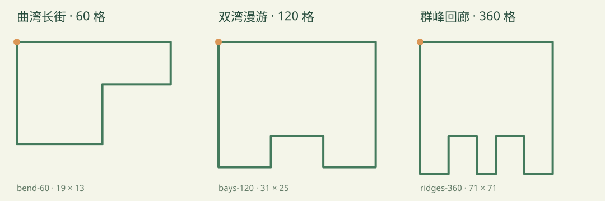

# 数据关卡与大地图压力测试

来源：[P007 背景艺术方案与规格](../proposals/P007-scalable-world-maps.md) · [Issue #94](https://github.com/SiliconYC/ReactMono/issues/94)。本轮背景只提设计，不修改场景地表、海面、雾或阴影。

## 三张地图



| 名称 / 标识 | 格数 | 坐标范围 | 特征 | 独立数据容器 |
| --- | ---: | --- | --- | --- |
| 曲湾长街 `bend-60` | 60 | 19×13 | 大折角、凹形长街 | [JSON](containers/bend-60.json) |
| 双湾漫游 `bays-120` | 120 | 31×25 | 湾口内折、双臂回路 | [JSON](containers/bays-120.json) |
| 群峰回廊 `ridges-360` | 360 | 71×71 | 两个深凹口、多段回廊 | [JSON](containers/ridges-360.json) |

这三张图都是真实关卡，选图后可使用既有规则、AI 和存档系统。用于扩展性测试，尚未进行局长、租金、银行利息或真人趣味性的平衡验收。格数不等于轮数：一轮是所有玩家各行动一次，不是绕地图一周。

## 唯一运行时数据源

`src/data/levels.json` 包含六个完整关卡容器：五张可选地图与内部 16 格 demo。`containers/` 是从该目录导出的交换副本，`outlines/` 是三张新图的创作轮廓。修改游戏应更新运行时目录；交付交换文件时同步导出，避免将副本误当成第二个运行时来源。

没有按地图 ID 分支的形状生成逻辑。规则注册、UI 列表、路线缩略图、开局、地块坐标和存档识别都读取同一目录；旧 API 的三张固定导出只作兼容别名。旧 demo 的地名、经济与坐标也来自目录。地图规则不依赖 React。

目录外层对象包含 `schemaVersion: 1` 和 `levels` 数组；数组中每项是完整关卡对象。上方三个 JSON 都是可以独立校验的实际容器。

每个关卡字段：

| 字段 | 含义与约束 |
| --- | --- |
| `name` / `description` / `playable` | 简体中文名称、说明与是否出现在选图页 |
| `map.id` / `map.version` | 稳定身份与正整数版本；ID 使用小写字母、数字、连字符，`custom-N` 保留给历史存档 |
| `map.columns` / `map.rows` | 正整数坐标边界，最大 10000，不代表全部格点必须占满 |
| `map.cells` | 按地块 ID 索引的 `{column,row}`，从 1 开始，无重叠、无越界 |
| `map.route` | 从地块 0 开始、包含全部 ID 一次的循环顺序；相邻项及末项→首项曼哈顿距离为 1 |
| `tiles` | 与 cells 等长，`id` 连续；0 为 `start`，其余为 `property` / `neutral`；地块名最多 100 字，地产有非负整数 `price` / `rent` |
| `initialCash` / `maxRounds` | 开局现金与默认轮数；选图应用默认轮数，玩家可再修改 |
| `eventRules` | 中立格 `tileIds`、奖金 `bonus`、费用 `fee` |
| `cardRules` | 中立格 `tileIds`、`rewardCash` / `moveBonus` / `maxHand`，参数遵循现有存档范围；不与事件站点重叠 |
| `facilityConfig` | 医院/监狱/商店的地块 ID、停留回合、费用、五类卡片价格与库存；或 `null` 表示无特殊设施。地点必须是不同的中立格，可与事件/卡站共用原有中立格语义；启用特殊设施时由设施接管停留行为 |

当前规则/存档支持 **4～512 格、正交相邻单闭环** 的正式关卡；历史 2 格等小测试存档继续兼容。这是现有游戏格式的边界，不是新背景方案的尺寸/形状边界。分叉、跨层与非格点路线需要另行版本化规则拓扑。地图可以凹入、多拐角、细长，不要求矩形周界。

已发布 ID 的几何不能直接改写，即使增加 version 也不能删除旧定义：否则原存档会被正确拒绝。变更布局使用新 ID，并保留旧定义；可令旧定义 `playable:false`，继续支持读档。

## 用 JSON 快速创作关卡

1. 参考 [60](outlines/bend-60.json)、[120](outlines/bays-120.json)、[360](outlines/ridges-360.json) 格轮廓文件，编辑 `id`、中文名称和轴对齐的拐点。最后一个拐点自动连接第一个，不重复写首点；所有线段长度之和就是格数。
2. 通用离线工具将轮廓展开为完整坐标、route、地块价格、事件/卡站及设施模板。它不包含任何具体地图 ID 或形状的分支；输出文件已存在时拒绝覆盖。

```sh
npm run maps:generate -- docs/maps/outlines/bend-60.json /tmp/bend-60.catalog.json
npm run maps:validate -- /tmp/bend-60.catalog.json
```

3. 直接编辑生成文件中的地名、价格、站点等；将其 `levels` 内对象追加到 `src/data/levels.json` 的 `levels` 数组。不要重复已有 ID；仅新增 JSON 条目，无需修改 TypeScript 注册表或 UI。
4. 运行校验与验证：

```sh
npm run maps:validate
npm test
python3 -u tests/browser_stress_maps_e2e.py
```

生成模板的经济参数只是起点，不代替平衡设计。也可以绕过轮廓工具，直接从外部编辑器输出同格式目录。运行时离线使用已打包目录，不从远程取图，不提供在游戏中导入未注册关卡的功能。

## 本地验证入口

- 主程序：[127.0.0.1:4174](http://127.0.0.1:4174/) → 开始游戏 → 选择地图；新图在原两图之后，准备面板可滚动。
- 原迁移 demo：[127.0.0.1:4173](http://127.0.0.1:4173/)，继续保留。

## 背景已知问题

压力地图已经实际暴露圆形地表漏承载、固定海面不足、远景雾/裁切及凹段地产仍按矩形外缘取锚点的问题。下列图片是本轮真实浏览器截图，**不是背景修复完成图**：

- [60 格桌面](evidence/bend-60-desktop.png)、[120 格桌面](evidence/bays-120-desktop.png)
- [360 格桌面](evidence/ridges-360-desktop.png)、[360 格手机](evidence/ridges-360-phone.png)
- [选图桌面](evidence/selection-desktop.png)、[选图手机](evidence/selection-phone.png)

后续采用 P007 的连续地表、局部分区景观、可见分块与独立地形数据方案，统一解决这些问题。本轮不借加入压力图之机调整背景或宣称画面可正式发布。
