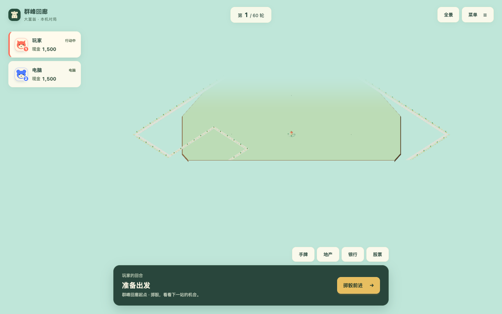
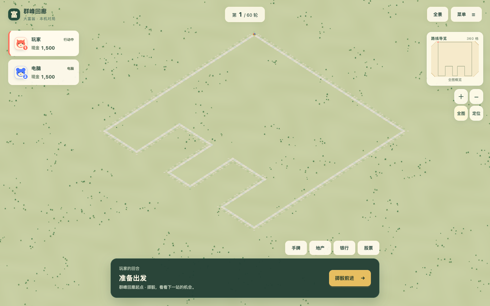
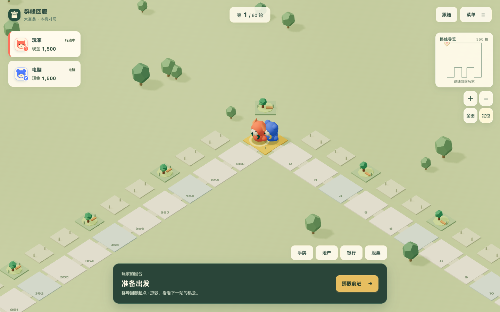

# P007 连续世界与大地图显示验收

2026-10-19 · [Issue #107](https://github.com/SiliconYC/ReactMono/issues/107) · [设计来源](../proposals/P007-scalable-world-maps.md)。本地验收通过，集成目标 `dev`；正式服务未发布。

## 实际变化

移除圆形承载台和固定海面，棋盘现在位于连续、按可见范围分块的草地世界。草地色块使用稳定世界坐标；远景细纹理淡出，绿化种子不消耗游戏随机数。道路、空地及树木采用实例化绘制。

地产按相邻路线和空间占用分配，门口朝向自己的路格。凹角、近平行道路和首尾接缝不会把建筑放在行走线上；若相邻空间不足，显示布局在2/4/6单位间距中选择能完成局部匹配的最小值，规则坐标、顺序和存档不变。建筑联排和自动装饰也检查道路及连接段的禁入区。

镜头支持全图、跟随、自由拖动、按钮/滚轮/双指缩放、方向键和 Home、小地图街区定位。60格以上新局默认清晰跟随；掷骰、租金和结局演出恢复适当镜头。手机全图模式收起小地图，为完整路线留出空间；局部模式显示数字与设施细节，高像素密度屏幕渲染上限为DPR 2。

裁切、雾和光照覆盖按真实视域计算，避免固定距离吞掉远端路线。使用当前Three.js 0.186.1支持的PCF阴影；所有网格统一投影和受影，包含新挂载的地表、LOD、角色和演出。阴影相机覆盖光空间投影，法线偏移随阴影像素尺寸统一调整，消除远景草地条纹，没有按物体类别关闭阴影。

## 真实画面

360格修改前：圆台边缘穿过路线，远端因雾和裁切消失。

360格全图：完整路线和凹口可见，没有台座边缘。

360格跟随：当前角色、路格数字、地产及阴影保持可辨认。

手机[全图](rendering-evidence/ridges-360-phone-overview.png)、[跟随](rendering-evidence/ridges-360-phone-follow.png)、[远端街区](rendering-evidence/ridges-360-phone-far.png)；其他地图：[20格](rendering-evidence/harbor-20-desktop-overview.png)、[60格](rendering-evidence/bend-60-desktop-overview.png)、[120格](rendering-evidence/bays-120-desktop-overview.png)。

另用规则生成、经过正式存档导入的360格满建对局检查大量房屋：[桌面近景](rendering-evidence/ridges-360-built-save-desktop-follow.png)、[手机近景](rendering-evidence/ridges-360-built-save-phone-follow.png)。这是明确标记的压力存档，不冒充自然养成进度或新的开局默认画面。

## 验证结果

| 检查 | 实际结果 |
| --- | --- |
| `npm test` | 170/170；含原有规则、存档及1000局独立模拟，以及新增布局/视域/光空间投影回归 |
| `npm run demo:build` | 通过 |
| `python3 -u tests/browser_scalable_world_e2e.py` | 20/24/60/120/360格 × 桌面1440×900 / 手机390×844，十组概览/跟随/远端、滚轮/拖动/键盘、小地图与真实移动；手机CDP双指通过；无页面或WebGL控制台错误 |
| 实际路线像素 | 360格两视口360/360路格采样命中；其他图19/20、23/24或全部，未命中样本位于角色/阴影覆盖附近；所有预期点均在HUD安全区，首尾与凹口另有定位/画面检查 |
| `python3 -u tests/browser_world_navigation_edges.py` | 越界后需求帧停止、拖动按住650ms再松手不误选、快速连点缩放、跟随状态同步、跨图存档与远端平局概览通过 |
| `python3 -u tests/browser_world_populated_e2e.py` | 360格满建存档桌面/手机近景及概览，四次导航切换后几何/纹理计数稳定 |
| 原 `browser_ui_rebuild_e2e.py` | 七视口、长名字/大额现金与200%等效视口通过 |
| 原 `browser_main_game_acceptance.py` | 十类金融/卡片/设施/演出/完整四人对局/旧档/文件往返/离线通过 |
| 原压力图及运行时 suite | 五图短局和离线，WebAudio、闲置GPU、坏档、覆盖/删除隔离、双SW更新通过 |
| 原 `browser_demo3d_e2e.py -v` | 8/8，包含地产联排、金融、租金、破产/胜利与窄屏 |

布局另覆盖320格超长双排和320格密集蛇形。后者先复现内部地产被挤到远处，再通过显示间距与局部匹配修复；不是只用方形周界证明扩展性。

## 性能与资源

环境为本机Chrome、ANGLE Metal / Apple M1。桌面DPR 1；手机为浏览器触控视口模拟、DPR 2，**没有物理手机**。帧时间是浏览器动画帧间隔，不等于独立GPU计时；没有测显存实际字节数。

| 桌面1440×900新局概览 | 修改前每帧绘制调用 | 修改后每帧绘制调用 |
| --- | ---: | ---: |
| 20格 | 433 | 175 |
| 120格 | 926 | 63 |
| 360格 | 1560 | 63 |

360格概览约减少96%绘制调用；后测计数包含实例化API，和渲染器统计交叉核对。全部十组新局概览及真实移动，帧间隔P50约16.7ms、P95约16.7–16.8ms；原始逐组结果见[acceptance.json](rendering-evidence/acceptance.json)。

满建360格概览约65次调用；桌面近景约637、手机近景566，帧间隔P95仍约16.7–16.8ms。四次近景/概览切换，近景几何计数均471、纹理均4，无逐轮增长。近景恢复真实建筑细节，因此不能把概览的63次调用泛化到所有对局状态。[满建记录](rendering-evidence/populated.json)保存每轮计数。

## 独立审查及失败修复

独立审查针对 `0b4a860` 提出六项问题，随后复核 `28ed53a` 确认全部消除、没有未处理的重要问题，可合入本地 `dev`：

1. 越界浏览未收敛导致减少动态模式持续刷新：比较并写回夹取后的目标，GPU停绘回归通过。
2. 跨图数字图集可能复用旧GLSL：按图集列数区分材质与程序缓存，实际同Canvas跨图读档及[画面](rendering-evidence/cross-map-atlas.png)通过。
3. 远端平局或自由浏览时遗漏结局：演出启动恢复合适镜头，真实远端平局[截图](rendering-evidence/large-map-draw.png)和操作通过。
4. 内部导航和顶部跟随开关不同步：通过回调同步，浏览器RED→GREEN。
5. 拖动后按住再松手误选：松手时延长本次手势的点击屏蔽，650ms回归通过。
6. 竖屏阴影只按世界轴半宽覆盖：真实Three.js光空间投影先失败，再扩大覆盖通过；没有关闭角落物体阴影。

草地着色器还曾使用GLSL保留字而编译失败，已由真实控制台检查发现并修正。最初小地图测试误把原生整像素输入当成可精确指定360个路格；现按SVG实际像素尺度验证街区定位，精确地块查看使用近景点击。原始RED、运行日志和[SHA-256目录清单](rendering-evidence/sha256.json)均保留。

## 集成、回滚和剩余范围

代码提交为 `0b4a860`、`044de57`；`28ed53a` 保留了断线期间并行研究文档，未移植外部项目代码。验收和文档收口后合入本地 `dev`。任务分支推送并建立指向远程 `dev` 的PR；现有远程 `dev` 推送会自动发布Pages，本任务未授权正式发布，因此不触发远程部署。Issue跟踪最终PR状态，#73保持开放。

撤销本轮渲染/布局/导航提交即可回滚；没有修改游戏规则、随机数、经济或存档格式。现有JSON地图和旧档继续使用同一规则数据。

独立区域地形格式、河流/海岸、分叉或跨层拓扑没有在本轮新增。当前游戏格式仍是4～512格正交单闭环；连续地表没有全图固定外边界，不构成无限性能承诺。物理手机GPU、热耗、长期资源增长及真人审美/趣味性仍需后续验收，不将本地通过标记成P4正式版完成。
