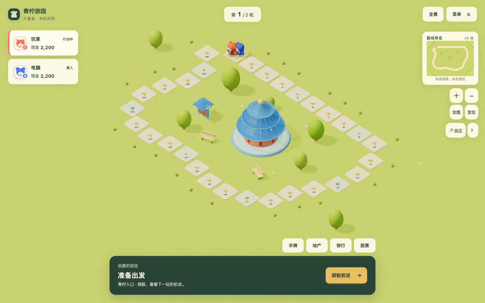
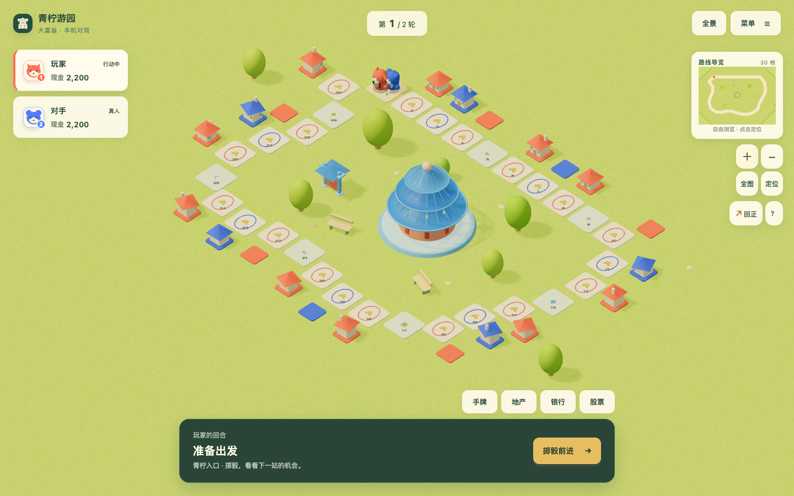

# 青柠游园：30 格独立风格探索

2026-10-22，来源：[P011](../../proposals/P011-isolated-style-maps.md) / [Issue #131](https://github.com/SiliconYC/ReactMono/issues/131)。集成目标为 `dev`；基线 `49880a7`。

## 实际交付

主程序新局准备页增加「青柠游园」。`src/data/levels.json` 仅追加 `lime-garden-30`；`LimeGarden.tsx` 提供专用地表、踏石、圆亭、牌坊、树木、花朵、长椅和地产表现。共享场景只增加针对该标识的入口分支。所有模型与纹理均由本仓库程序绘制，没有导入海报图片或外部商业素材。

视觉研究重点是连续的青柠草甸、浅奶油圆角踏石、低矮贴地几何、蓝顶地标和玩具感装饰。游戏网站沿用现有界面。产权色环、彩色地基和建成小屋仍对应真实地产状态。

[手机全景实拍](evidence/overview-phone.png)保留完整界面；全景用于路线概览，细节需放大或定位玩家。

## 隔离与验证

- 原六个完整关卡容器逐对象比较，与基线完全相等，包括规则、坐标、地形、景物和经济参数；证据见 `evidence/isolation.json`。
- 未修改共享美术组件、全站样式、页面流程、核心规则或存档格式。继续使用场景统一的灯光和投影/受影规则，没有对低矮对象关闭阴影。
- `npm test`：197 项通过。新增测试以种子 `17`、`31`、`88` 验证 30 格开局、12 轮模拟终局、零拒绝动作和完整存档往返。
- `npm run maps:validate`：7 个容器全部通过，其中 6 个可选、1 个内部关卡。新图通过既有旋转足迹、地产、道路、景物占用与相机取景检查。
- `npm run build` 与 `npm run demo:build` 均通过。`demo:build` 仍有大块体积提示，不将构建成功解释为真机性能合格。
- `python3 tests/browser_lime_garden_e2e.py`：生产静态页面在桌面 `1440×900`、手机 `390×844` 视口中完成真实选格、购地、住宅建设、两轮完整对局、旋转/缩放、文件导入导出、刷新后手动存档读取。满建存档全量相等；页面及控制台错误为零。结果见 `evidence/browser-report.json`。
- `python3 tests/browser_stress_maps_e2e.py`：六张可选地图均完成桌面选图、真实掷骰、存读档和完整短局；原 `ridges-360` 手机用例继续通过，包含该地图桌面的离线恢复。结果见 `evidence/existing-maps.log`。
- 新验收脚本已加入 `CI`。原压力地图脚本的手机验收改为明确选择 `ridges-360`，避免新增目录末项后无意丢失既有 360 格手机覆盖。

## 发现与修正

- 首轮空间检查发现入口相邻路砖重叠、两块地产过近和外围花朵侵占地产：调整新图显式坐标，保留原空间约束。
- 首轮浏览器画面发现圆亭屋面朝内：修正旋转体轮廓方向；合并屋脊为实例批次后，空场实测绘制调用从 247 降为 157。此采样是本机视口数据，不代表所有设备。
- 全量测试发现矩形辅助草甸导致全景收进过多空白：缩小辅助轮廓，保留连续草地基底和共享相机算法。
- 独立审查发现住宅底面比地基顶面高 `0.04`：按实际几何包围盒调整房体高度，使底面为 `GROUND_TOP + 0.06`，与地基贴合；审查者复核通过。
- 浏览器脚本首轮漏点多人交接提示；新增选格探针首轮将屏幕纵向投影方向写反。两项均修正验收驱动，未为通过测试修改游戏流程。
- 独立审查要求补齐刷新后的存档断言，已增加地图/场景等待及前后全量局面比较，复核通过。

## 限制与交付

尚未取得物理手机、真人偏好与长局经济平衡结论；不因此宣称已确定最终美术风格。`#73` 的完整正式版验收保持开放。未发布正式网站，本次推送使用 `[skip actions]` 避免 `dev` 的自动发布流程。

本地入口：`http://127.0.0.1:4174/ReactMono/` → 新游戏 → 青柠游园。原迁移演示继续使用 `http://127.0.0.1:4173/`。
