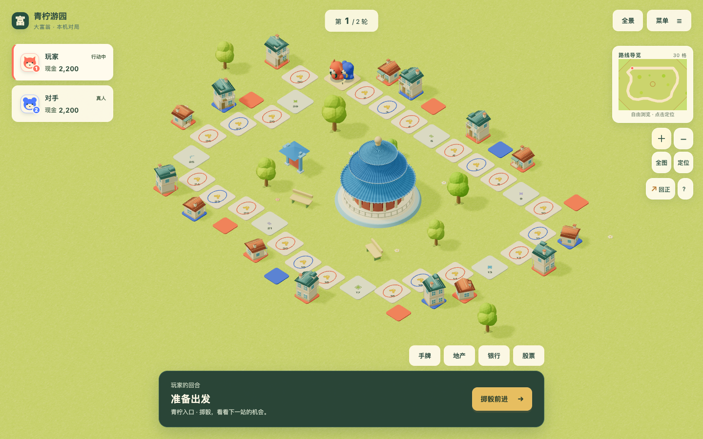
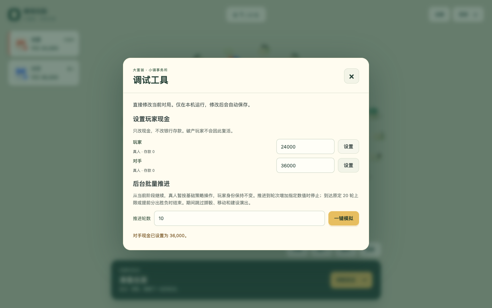

# 青柠游园造型修订与全地图调试工具验收

2026-10-22，基线 `ed2f20a`。来源：[P011 造型反馈](../../proposals/P011-isolated-style-maps.md) / [#132](https://github.com/SiliconYC/ReactMono/issues/132)，以及 [P012 调试工具](../../proposals/P012-local-debug-tools.md) / [#133](https://github.com/SiliconYC/ReactMono/issues/133)。

## 对所有者反馈的实际回应

首轮单椭球树冠、稀疏圆亭和近似的两级住宅没有得到所有者认可。先前可玩测试通过不等于这些造型已经合格。本轮保留青柠游园的地形和路线，重做专用模型：

- 树有分叉树干、五簇不同尺度的树冠、面向光照的颜色层次和少量果实；继续采用受控低多边形表面。
- 圆亭每层屋面有 64 道真实瓦垄，配合叠檐、瓦当、平台台阶、柱廊及栏杆。不是只在平滑曲面上放几根直线。
- 一级为单层暖顶庭院小屋，有门廊、花箱、烟囱和分格窗；二级采用独立的两层住宅、阳台栏杆、山墙小窗与蓝绿色屋顶。背立面和侧面也补充窗户，避免旋转后只见空墙。
- 新建和升级有约 `0.82` 秒的升起、轻微回弹与落定尘雾，锚点固定在地基顶面。减少动态直接完成；初始挂载、读档和批量模拟不重演历史。

[一级近景](refinement-evidence/level1.png) / [二级近景](refinement-evidence/level2.png) / [建设中实拍](refinement-evidence/construction.png)。这些是生产静态页面的真实截图；不把截图存在或测试通过解释为所有者已认可最终风格。

## 通用调试工具

每张可选地图的游戏菜单增加「调试工具」。逐玩家输入现金并点击「设置」；输入要推进的轮数，再点击「一键模拟」。计算在本机 `Web Worker` 中进行，复用真实规则和策略，成功后一次性更新游戏状态与场景。

现金只改对应玩家现金，保留银行存款、产权、随机状态、真人/电脑身份和破产标记。其他玩家尚未提交的输入不会丢失。终局只供查看，不通过加钱复活玩家或更改既有胜负结果。

批量推进从当前阶段继续，到轮次增加指定数值时停止；原对局轮数上限和提前胜负仍有效。真人临时使用基础策略；模拟结束后仍由原玩家操作。关闭或取消计算、发生错误或超时时保留原局；过期回包不能覆盖已经切换的游戏。沿用既有存档事件容量与动作上限，超过限制会明确失败，不删除历史或放宽校验。

[手机调试面板](refinement-evidence/debug-phone.png)。输入范围和本机对局说明位于工具内，不改变网站其他功能流程。

## 验证结果

| 验证 | 真实结果 |
| --- | --- |
| `npm test` | 210 / 210 通过；新增现金、模拟、真实 Worker 消息协议、输入草稿、屋面几何、住宅包围盒及动画起止测试 |
| `npm run maps:validate` | 7 个关卡容器通过；完整目录与基线逐对象相同，包含新图，见 `isolation.json` |
| `npm run build`、`npm run demo:build` | 均通过；演示构建保留大块体积提示 |
| `browser_garden_construction_e2e.py` | 双视口一级/二级真实建设动画、落定与存档等级正确；减少动态两级直接显示；6 项场景通过 |
| `browser_debug_tools_e2e.py` | 六图桌面与青柠手机共 7 场景，实际创建 8 个 Worker；现金、草稿、非法输入、推进 1～3 轮、完整 `GameState` 比较、无历史演出及两真人继续掷骰交接全部通过 |
| 手机离线 Worker | 等待 `Service Worker` 接管并确认 Worker 已缓存后断网，创建新的 Worker 推进一轮，完整状态仍与规则结果相等 |
| `browser_ui_rebuild_e2e.py` | 原七视口界面、准备、购地、银行、焦点以及长姓名/大金额/放大视口检查通过 |
| `browser_main_runtime_e2e.py` | 音效与 GPU 停绘、真人交接、文件拒绝与存档、电脑完整局、双 `Service Worker` 更新和断网恢复全部通过 |
| 独立代码审查 | 新增定向测试 13 / 13 通过；未发现阻断问题，明确不代替所有者的美术判断 |

原始日志、浏览器报告及几何隔离记录保存在 `refinement-evidence/`。浏览器没有控制台错误或页面异常；出现既有 `THREE.Clock` 弃用提示和正常的场景卸载日志，不将其伪装为零警告。

## 失败与修正

- 新圆顶第一轮几何测试发现索引顺序导致法线朝内；调整三角面顶点顺序后通过。住宅部件合并时缺少统一属性，去除不使用的纹理坐标后统一顶点格式，实际包围盒测试通过。
- 现金设置原本会覆盖其他玩家未提交草稿；独立的草稿同步函数先复现失败，再验证仅同步真正改变的现金。
- 全地图浏览器第一次确认 Worker 结果已完成，但打开的调试弹窗使新挂载场景被设置为 `frameloop="never"`，导致加载永不结束。失败原始记录保存在 `debug-first-failure.log`。修正为未就绪场景先用需求帧完成准备，准备完成后才暂停。全图重新运行通过，原模态 GPU 停绘回归也通过。
- 建设验收脚本最初重复注册对话框处理器，调试脚本最初用精确文本漏匹配带箭头的投骰按钮；均修正验收驱动，没有为测试修改产品按钮或游戏流程。

## 隔离、交付与限制

所有关卡容器完全不变。旧美术组件、路线、规则及存档格式未修改；只对全地图增加已授权的调试入口，并修正新场景在暂停状态下的准备过程。所有新模型继续使用统一光照与投影/受影，不按对象高度关闭阴影。

集成并同步 `dev`，使用 `[skip actions]` 避免自动正式发布；远程 CI 未执行，以上为本地真实验证。`4174` 主程序与 `4173` 演示服务继续保留。尚未进行物理手机、长期高轮数真人测试或风格偏好调查；`#73` 保持开放。
