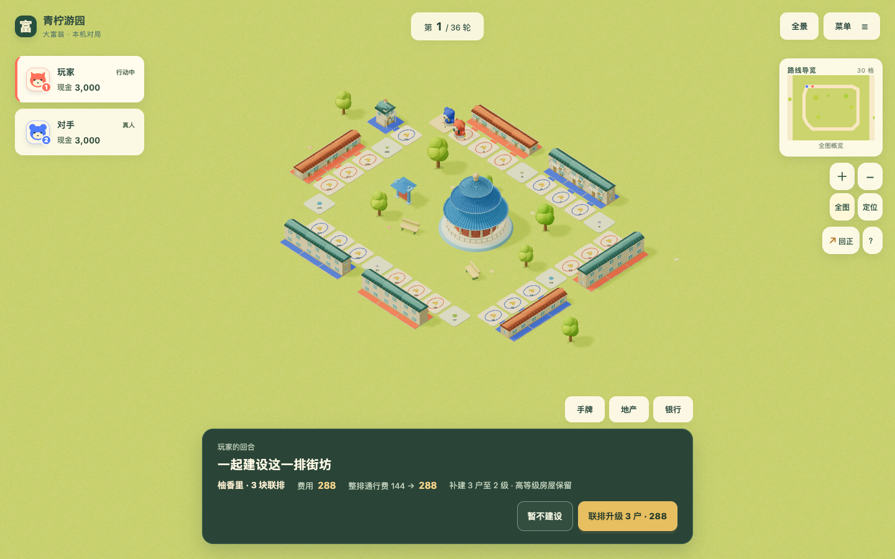
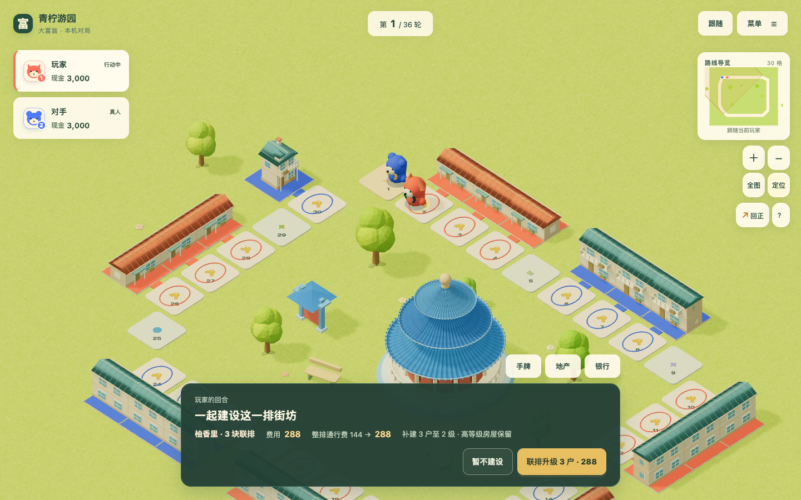

# 青柠游园联排经营验收

2026-10-22，基线 `d38f371`，来源 [#136](https://github.com/SiliconYC/ReactMono/issues/136) / [P011](../../proposals/P011-isolated-style-maps.md)。[设计与实施账本](terraces-design.md)登记具体规则、边界和验证方法。仅本地验收，不发布正式服务，不代替 `#73` 的真人与正式版综合验收。

## 实际改变

历史联排识别仍存在，但只用于部分旧场景的已建住宅表现；主规则仍逐格升级、收费，青柠住宅又独立渲染。本轮为青柠建立八个明确街区，七个三块街区及一个转角独立地块，地产按两米正方形紧密排列，步行格距所属地产中心 `2.15` 米且正对门面。连续房屋使用实际共墙和接合横脊，不以跨路桥梁或视觉连线代替建筑。

新青柠对局的连续同主土地（包括空地）形成经营单元。到访任意成员可一次建设最低层成员，按各户真实费用合计扣款；不足整笔时不扣款、不建任何一户。满级住宅落点可以补建低等级邻居，每次停留仍限一次购买或建设。

本作沿用土地 `0`、住宅 `1`、高级住宅 `2`。例如先有高级住宅再买两块空地：`[2,0,0] → [2,1,1] → [2,2,2]`；高等级保持投资，新成员逐层付费。对手在任一成员支付整排各自当前租金之和，没有额外不透明倍率。三块基础租金 `24` 的土地收费 `72`，全部高级住宅收费 `288`；混级 `[2,0,0]` 收费 `144`。抵押、出售、未购或他人产权截断，解除抵押或重新购入后实时重算。

[手机全景](terrace-evidence/populated-phone.png) / [手机混级补建报价](terrace-evidence/mixed-before-phone.png)。截图来自本地生产静态页面的真实 `WebGL` 渲染和公开存档入口；不表示真人已经认可最终美术。

## 规则一致性与兼容

`property-groups.ts` 为交易、电脑、后台模拟与界面提供同一分段、费用和租金报价，不依赖渲染器。建设按户记真实事件，现金一次原子扣除；免租覆盖整笔，存款救急、出售清算和破产仍走既有账本。

新青柠局保存 `terraceRulesVersion:1`，规则本身强制到访和每次一次，不依赖调用方再设置旧开关。无标记的历史存档继续逐格经营；不在读档时悄悄换规则，玩法说明和详情标明旧版。体验新规则需新建青柠游园对局。其他地图不能启用该版本，另六张关卡的完整数据与基线逐对象相等。

## 已取得的验证

| 检查 | 结果 |
| --- | --- |
| `npm test` | `281/281` 通过，基线为 `266/266`；涵盖整排原子扣款、混级、满级落点、买地接排、断排/恢复、免租、破产、存档与两种 AI |
| `npm run build` / `npm run maps:validate` / `npm run demo:build` | 通过；七关地图校验通过，演示构建保留既有大包提示 |
| `browser_lime_terraces_e2e.py` | 桌面 `1440×900`、手机视口 `390×844`、减少动态共三组；真实整排新建、混级补建、一次收费 `288`、不足总额按钮禁用、旧档提示及文件往返通过；控制台错误和页面错误均为空 |
| 既有青柠浏览器回归 | `browser_lime_garden_e2e.py` 的双视口新局、购地、建设、完整结算、存读档与导航通过；`browser_garden_construction_e2e.py` 的双视口两级建设动画和减少动态六场景通过 |
| `lime-terrace-audit.mjs` | 新旧规则各 `100` 局，共 `200` 局、`160882` 次动作，动作合法、逐动作现金流精确、全部存档往返；新规则实际发生 `482` 次多户建设、`2967` 次整排收费 |
| 数据隔离 | `classic-24`、`harbor-20`、`internal-square-16`、`bend-60`、`bays-120`、`ridges-360` 六张完整关卡数据与基线一致 |
| 独立只读审查 | 初次全套 `280/280`；发现一项到访开关依赖问题，修正后定向 `25/25`，最终本轮全套为 `281/281`；无遗留 P1/P2 发现 |

原始日志、截图、浏览器记录和每局统计见 `terrace-evidence/`。审计种子为 `20261022–20261071`，两人/四人、新旧规则分别运行；每局观察至第 `151` 轮或提前破产。新规则 `83/100` 局结束，结束局轮数中位数 `84`；旧规则 `56/100`，结束局中位数 `116`。这只能说明本样本里连地经营增强了收费压力，不能将未结束局剔除后声称无偏总体速度或成熟平衡。剩余 `61` 局如实保留进行中状态。

## 失败记录与修正

- 首轮全套 `274/275`：旧经济测试修改基础土地租金后，通用报价误读升级表的第零项。恢复原规则的基础租金取值，原测试通过，未削弱断言。
- 截图发现瓦条尖刺；几何约束测试先复现失败，再修正两侧屋面旋转方向，保证瓦垄贴合屋面。
- 首次浏览器执行已通过桌面建房与租金，在旧档说明检查时因脚本错用「帮助」菜单名超时；按真实按钮「玩法说明」修正驱动并完整重跑，保留失败日志。
- 独立审查发现仅启用联排标记、不带旧到访开关的核心调用可远程反复建设。新增直接入口回归先失败，再让规则本身强制限制，并移除策略 AI 的旧短路判断。

## 交付边界与回滚

原有端口调整经所有者确认保留；主程序预览使用 `http://127.0.0.1:23010/`，独立 demo 仍使用 `4173`。临时分支只在本地，验收后合并并同步 `dev`，提交使用 `[skip actions]`，没有触发正式发布。

未做物理手机、长时间真人对战或全面经济调参；本轮将联排规则、可玩行为和可见建筑关系落实，不宣称商业级视觉或完整 P4 完成。回滚实现提交可恢复原规则；回滚前应备份带新标记的存档，因为旧版本校验不认识新增可选字段。
