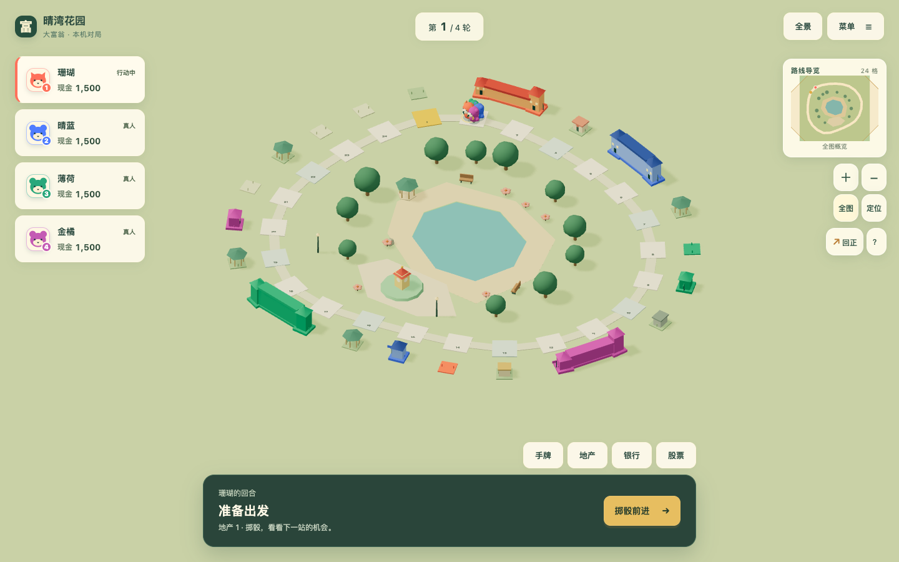
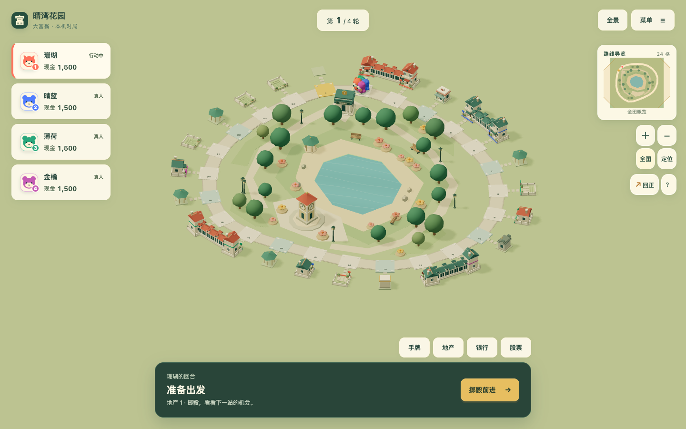
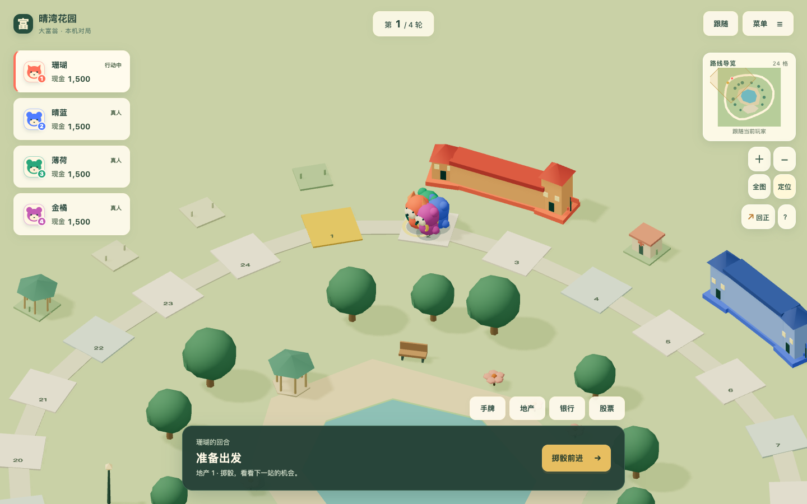
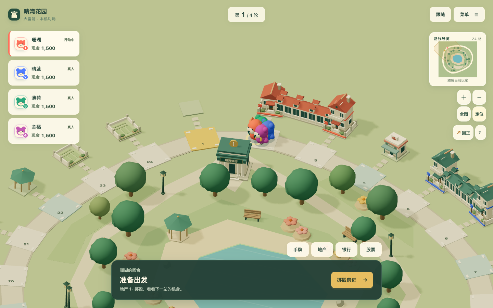
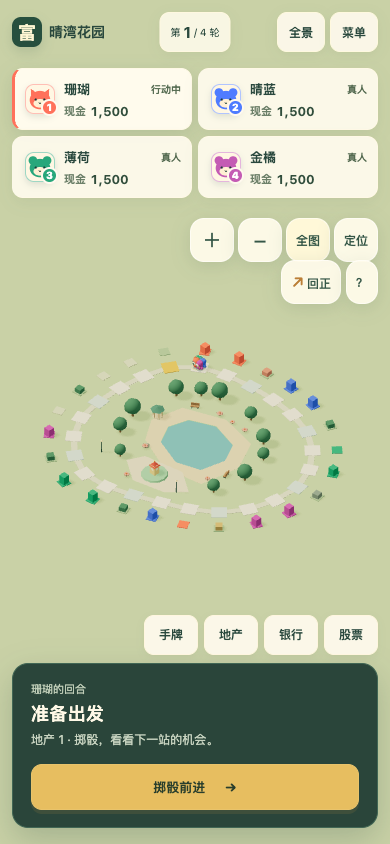
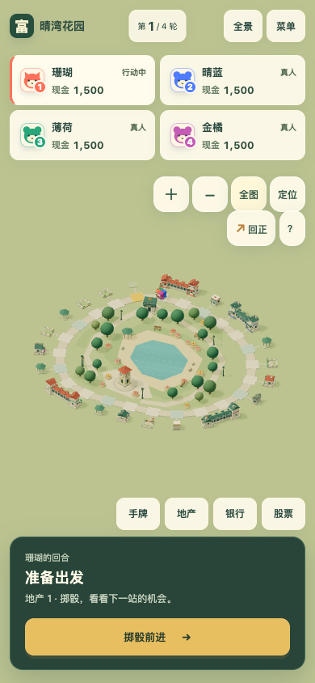
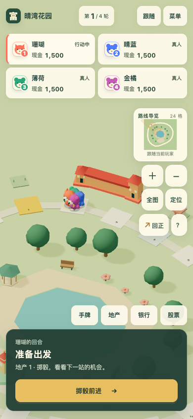
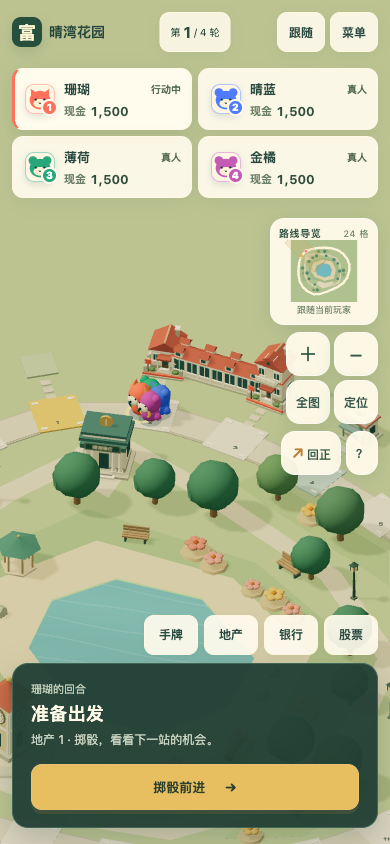

# 晴湾花园：24 格立体小镇美术深化

2026-10-21。来源：所有者定向任务，整合 `P010` 的 `T01/T02/T03/T09/T10`；[#127](https://github.com/SiliconYC/ReactMono/issues/127)，[PR #128](https://github.com/SiliconYC/ReactMono/pull/128)，集成目标 `dev`，起点 `56d5aef`。本任务不等于 [#73 正式版总验收](https://github.com/SiliconYC/ReactMono/issues/73) 完成。

## 保留与深化

继续使用原创低多边形、明亮暖色、彩色坡顶、柔和绿地和正交微缩比例。没有替换设计方向、角色、规则或场景系统。

- 住宅由简单方盒成长为有基脚、门廊、窗框、侧窗、屋檐、烟囱、阳台和山墙的形体族；`0` 级仍是空地，购地不自动建房。四种业主使用地界、腰线和带席位点数的产权牌，墙面保持统一暖色。
- 联排采用较低的有窗廊道连接，两端等级保留，增加坡屋面、柱间和重复山墙；连接不改变租金，不跨道路。
- 道路补充连续路缘、角石和通向地产的步石；选中地块有独立边线，住宅屋顶、墙体与设施可以识别所属地块。抵押同时有前院标牌、屋顶封条和详情文字。
- 银行有柱廊、金色标志和中文招牌；商店有条纹遮棚与货台；医院有医疗标志和入口雨棚；拘留所有岗楼与栅窗。钟楼增加四面钟盘、指针、刻度、檐口和基座。
- 只精修 `classic-24.world`：环湖草坪、林下与北岸步道、银行前庭、花坛、成组乔木、座椅和灯具连接原有荷塘与钟楼广场；水面增加静态细纹。所有景物有显式记录，运行时不随机填景。

银行是既有金融操作的视觉地标，不新增“到访银行”规则。港湾与其他关卡的显式场景、所有地图规则/价格/租金/拓扑摘要保持不变；共享建筑与光照改进会在其他地图显示。

## 真实画面对比

同一正式存档：[固定局面](evidence/town-state.json)，种子 `17`，四人同格，四种产权、空地、一级/二级、联排和抵押。受控状态经正式序列化与导入验证，用于比较表现，不冒充自然养成进度。两版的样本 `SHA-256` 均为 `dad4529677c09f1faede43c9ee5b77fb130ec5ed49b4c69679e896e5e1daad0d`。

桌面 `1440×900`，改前与改后：

手机 `390×844`，改前与改后：

补充：[旋转改前](evidence/before-desktop-rotated.png)、[旋转改后](evidence/after-desktop-rotated.png)、[零级与一级产权近景](evidence/after-desktop-state-7.png)、[选中和抵押住宅](evidence/after-desktop-state-11.png)、[手机抵押与选中](evidence/after-phone-state-11.png)。

`before.json` / `after.json` 记录实际相机。跨平台首次CI因HUD边距不同而在精确相机断言失败，见[失败与修复](evidence/checks/ci-first-failure.txt)。CI在同一runner上构建原始`56d5aef`并复拍改前/改后，输出到`artifacts/town-art`；不能把Linux字体下的HUD边距与Mac基线直接混比。复拍直接核对模式、安全区、中心、方位、俯仰与缩放；不通过改成自由镜头来伪装同镜头。独立审查已逐项核验，手机概览居中且不裁切。

## 验证与资源

| 检查 | 本地真实结果 |
| --- | --- |
| 构建与 Node 回归 | `npm test` 191/191；含规则摘要、存档、100种子与既有完整模拟，新增占地/成长/屋面绕序/后窗方向及绘制预算检查；[日志](evidence/checks/node.log) |
| 关卡与迁移 demo | `maps:validate` 六张校验通过；`demo:build` 通过，既有大包提示保留；[关卡](evidence/checks/maps.log)、[构建](evidence/checks/demo-build.log) |
| 软件渲染 demo | 显式 SwiftShader 完整 9/9 通过（含新增无WebGL闭环）；软件渲染加四倍CPU限速的三个桌面首回合也通过；角色/移动及原断言未改；[日志](evidence/checks/demo-sw.log) |
| 实际经营闭环 | 买地、到访建设/升级、出售、抵押借还、租金、设施、两图四人完整局及正常/快速最终状态等价通过；[日志](evidence/checks/main-game.log) |
| 旧档和离线 | 主程序旧现金股票/异地建设规则、文件往返、PWA缓存后断网重载与自动续局通过；同上日志 |
| 镜头/拾取/触控 | 24/360格桌面与手机旋转、缩放、菜单、回正、数字朝向、触屏及二级屋顶右键/普通左键通过；[结果](evidence/checks/camera.json)、[日志](evidence/checks/camera.log) |
| 导航边界 | 减少动态越界停绘、拖动松手不误选、远端终局回概览及跨图存档通过；[日志](evidence/checks/navigation-edges.log) |
| 满建360格 | 双视口各四轮跟随/概览导航，无几何/纹理累积；跟随桌面176、手机166次绘制，纹理4；[原始结果](evidence/checks/populated.json) |
| 既有2000局对照 | 原实验1000对完整执行，无非法动作；原候选仍拒绝，没有采用经济或策略变更；[汇总](evidence/checks/balance-summary.json) |
| 运行时与更新 | WebAudio回收、GPU闲置停绘、坏档拒绝、保存删除、人机交接、双Service Worker升级/旧缓存清理及离线续局通过；[结果](evidence/checks/runtime.json)、[日志](evidence/checks/runtime.log) |
| 完整远端CI | 包含demo、七视口、完整对局、五图、360格、离线/双SW和新美术截图；最终结果与运行日志见[PR检查](https://github.com/SiliconYC/ReactMono/pull/128/checks)，全部通过才可合并 |

满建360格采样的帧间隔 `p50/p95` 约 `16.7ms`，来自本机 Chromium 与模拟手机视口，不能推广为物理手机 GPU 性能。近景住宅使用三批实例，钟楼刻度与静态设施盒体也合批。固定桌面近景由原版483次绘制降至373次，几何资源244→191；手机由187次升至371次、几何95→190，因旧版手机近景曾简化为色盒。两视口纹理均由4增至8，细节与三角形成本仍上升，未宣称所有指标下降。减少动态初始帧的统计可能为零，不作为性能结果。

资产全部为本仓库程序几何、显式JSON及可释放Canvas招牌，无新第三方资源、运行时CDN或外部图像。来源、源文件、重建命令、打包字节与预算见[资产清单](ASSETS.json)。未放宽既有测试预算；三维资源沿用统一阴影策略和当前Three.js支持的`PCFShadowMap`。

## 独立审查与剩余缺口

独立审查确认设计语言继承、住宅/设施/景观有肉眼可见改善，规则摘要未变、联排不跨路，修复后没有新增合并阻断。审查曾发现手机对比镜头失配、普通屋顶点击缺失和后窗朝向错误，现已分别以相机数据、真实点击和单测复核修正。画面检查另外修正屋面绕序、树冠穿插、无目的外围树造成的取景缩小，以及背向建筑时抵押牌被遮挡。

最终独立复核已查看针对性手机与桌面抵押/选中画面，关闭此前产权证据缺口；`camera.json`记录`leftClickRoof: true`。

仍然存在：详情卡片覆盖小地图时背景文字略透出，桌面抵押文字可能换行；手机近景右侧控件遮挡部分相邻建筑。联排偏向有窗连廊而非完整住宅街；设施体块变化和湖面纹理仍较简约；手机全景主要用于导航，产权点数及小招牌需要近景或详情读取。无物理手机、热耗、真人可读性或审美满意度数据。不能据此宣称已达到成熟商业游戏的全部品质要求，更不能关闭`#73`。

本地压力脚本首次在浏览器退出阶段长时间无输出；补充周期日志和超时堆栈后，完整双视口四轮及资源断言实际通过。该诊断没有改变资源门槛或把中止当通过。运行时套件一次在与GPU压力验收并行时未在固定650ms内收到全部音效结束回调，独立顺序重跑全部通过；保留远端顺序CI作为最终门槛，未修改音频逻辑和断言。所有实际失败与修复以提交、日志和PR检查保留。

远端另一次完整CI在demo桌面首回合未观察到中间行走格，见[慢帧记录](evidence/checks/ci-demo-slow-frame.txt)。保留角色、移动实现和原断言，改为合批设施盒体，精修版近景绘制由725降至373次；独立复核已检查父级变换、卸载更新、实例拾取和统一阴影。本地隔离软件渲染的三个桌面首回合及完整8项套件通过；最新远端CI继续作为门槛，单独重跑不能替代全量验收。

后续CI仍复现同一失败，因此没有把合批当作根治。软件渲染加四倍CPU限速时，时序证据明确显示投骰在约1.0秒发生，而场景到6.3秒才创建完成。现将两个宿主的投骰和主程序电脑入口门控到真实初始化绘制完成；不改变角色和移动代码。相同条件三次首回合通过，见[修前时序](evidence/checks/startup-before.log)、[修后时序](evidence/checks/startup-after.log)、[三次限速复测](evidence/checks/startup-cpu4.log)。专用错误边界只接收renderer构造失败，正常场景错误继续抛出；无WebGL降级仍可完成原回合操作，见[降级测试](evidence/checks/no-webgl.log)。

无WebGL降级另以真实主程序复验：正式读档、真人投骰买地、电脑首行动及交接真人回合通过，见[主程序降级续局](evidence/checks/main-no-webgl.log)。这只处理画布不可用时的界面到达解锁，规则和演员实现不变。

完整远端CI继续推进后，手机360格旧像素检测报338/360。独立审查未见实际断路；检测使用跨帧相机值、两位缩放和偏离像素中心的取整。在[同一稳定截图](evidence/checks/road-projection.png)中，原取样338格，使用实际投影与包含该点的像素后358格；[原始坐标/颜色](evidence/checks/road-projection.json)、[核查记录](evidence/checks/ci-road-pixels.txt)保留。现等待真实镜头稳定并记录每图采样，原颜色条件和94%门槛不变，没有改材质或关阴影来规避。

最新远端慢帧再次漏过中间格，说明初始化门控不能解决持续渲染成本。现以实际已绘制帧的五个间隔中位数选择全场景预算（前两帧不采样，超过50ms时使用统一1024阴影及近景0.65像素比例）；默认仍为2048与设备像素比例。原PCF、统一投影/受影和动态texel对齐保留，角色、骰子与动作时间未修改。远景路砖投影不足4个CSS像素时恢复原设备像素比例，避免大地图细路继续降采样。这是保守的启动预算，采样仍可能含上传成本，不是纯GPU基准；本次Canvas生命周期选低后不反复升档。

同一CPU八倍限速的SwiftShader桌面动作片段，原预算和仅降阴影时帧间隔中位/95分位均约83.3ms；当前预算约50/50ms。保留[原预算](evidence/checks/render-budget-before.log)、[仅降阴影](evidence/checks/render-budget-shadow-only.log)、[当前动作轨迹](evidence/checks/render-budget-cpu8.log)。仅代表本机软件渲染对照，不能外推真机；低档实际画面会更软：中文小招牌、产权点数与窗框变糊；手机抵押封条需结合详情文字确认，不宣称图形信息无损。另以原固定存档完成[低档全组截图](evidence/efficient/after.json)，例如[桌面近景](evidence/efficient/after-desktop-near.png)和[手机抵押](evidence/efficient/after-phone-state-11.png)。正常设备复拍仍选full，原精修截图逐字节不变。

预算准备阶段的减少动画检查曾因R3F在after-effect之前决定停绘而卡住；已在useFrame内请求预热帧，准备完成后停止。真实主程序双视口、原相机断言、191项Node及显式SwiftShader完整9项复验通过，未以延长等待隐藏卡住。

低档360格另以同样SwiftShader加八倍CPU限速执行完整原路线/导航/双指/移动帧检查，两视口均通过，错误为空；远景实际恢复桌面DPR1、手机DPR2，道路命中359/360和358/360，原94%门槛不变，见[原始结果](evidence/efficient/ridges/acceptance.json)、[日志](evidence/checks/render-budget-ridges.log)。极端限速下全景帧间隔中位数仍约116.7ms，不能称流畅或把24格近景提速外推为大图全景性能。

## 重跑、集成与回滚

先执行`npm test`，再运行`TOWN_PHASE=after python3 tests/browser_town_art_e2e.py`；不要在改后代码上运行`before`覆盖历史样本。其他入口为表中的既有脚本，主程序`npm run main:dev`在`127.0.0.1:4174`，迁移demo`npm run demo:dev`在`127.0.0.1:4173`。

冷启动可复测：`DEMO_SWIFTSHADER=1 DEMO_CPU_THROTTLE=4 PYTHONPATH=tests python3 -m unittest browser_demo3d_e2e.Demo3DBrowserTest.test_desktop_full_turn -v`。软件渲染完整套件：`DEMO_SWIFTSHADER=1 python3 tests/browser_demo3d_e2e.py -v`。不要同时运行多个GPU验收来比较时序。

所有者授权覆盖合并`dev`，未授权发布正式服务。仓库`dev`推送会触发Pages，因此PR完整CI通过后，合并提交使用`[skip actions]`阻止该次自动发布；不修改部署工作流。最终合并SHA与Issue关闭状态见PR。回滚本PR表现提交即可，既有存档不迁移、不清空。
